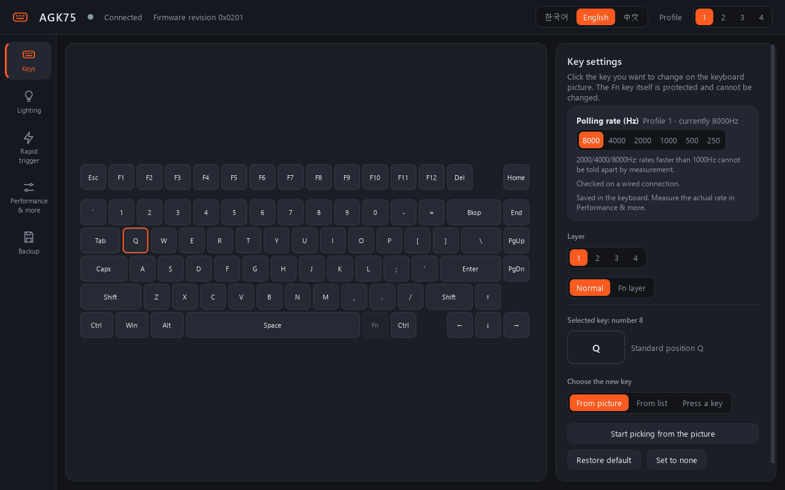
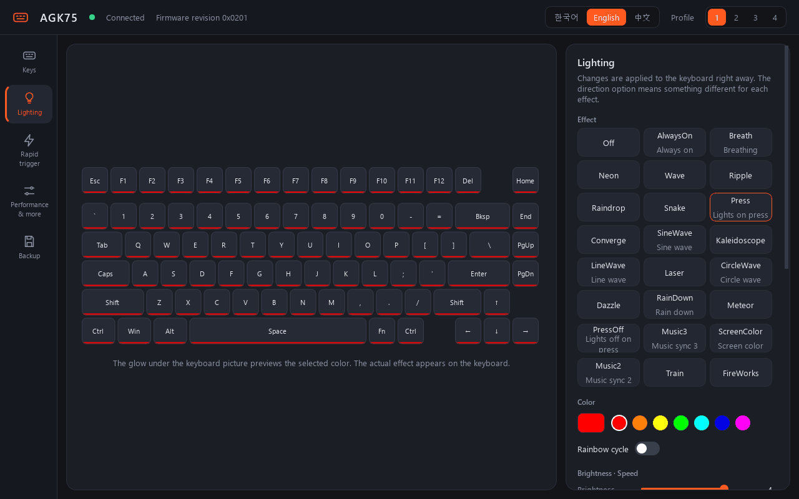
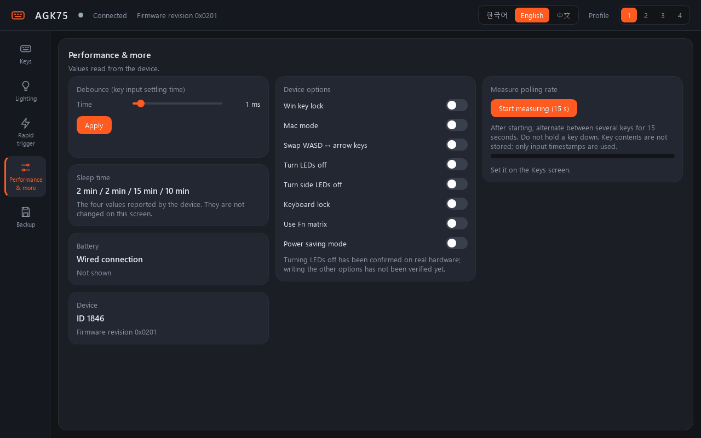

# agk75-tool

[한국어](README.md) | **English** | [简体中文](README.zh-CN.md)

> **This is an unofficial tool, not affiliated with Antgamer. The product name is used only to indicate which device it works with.**
>
> No liability is accepted for any damage arising from its use.

A small program for configuring the ANTGAMER AGK75 (USB 3151:5009) while it is connected with a USB cable.
It uses only Python 3.11, `hidapi` (`import hid`), and `PySide6` (Qt: QtCore, QtGui, QtWidgets, QtSvg). The UI is a native PySide6 window: no CDN, and no outside connections.
The UI language is Korean, English, or Simplified Chinese; switching it in the top bar redraws everything at once (it follows the Windows display language at first and remembers your choice in `%AppData%\DO0OG\AGK75Tool.ini`).
All device and measurement work runs one after another on a single worker thread; the UI only receives the results and updates itself.

This program is an independent implementation based on an analysis of how the manufacturer's web configuration tool communicates.

## License

MIT License (`LICENSE`), copyright DO0OG.

## Dependencies and sources

- `hidapi` (Python binding, `import hid`): available under GPLv3, BSD, or the original hidapi license; this program uses it under the **BSD license**.
- `installer\ChineseSimplified.isl`: the Simplified Chinese translation file for Inno Setup 6.5.0+ (listed at https://jrsoftware.org/files/istrans/ , original at https://raw.githubusercontent.com/jrsoftware/issrc/refs/heads/main/Files/Languages/ChineseSimplified.isl ), bundled for the setup wizard. Its license is the same as Inno Setup's.
- `PySide6` / Qt 6 (PySide6-Essentials: QtCore, QtGui, QtWidgets, QtSvg): used under the **LGPLv3**. The Qt libraries are shipped as separate DLL files in the install folder, so they can be replaced with another build of the same version. Source: https://code.qt.io/cgit/pyside/pyside-setup.git/ ; the notice is `installer\THIRD-PARTY-NOTICES.txt` (also installed into the app folder). Not affiliated with The Qt Company.
- Everything else uses only the standard library. Nuitka is used for the build and Inno Setup for the installer.

## Running

```
pip install hidapi PySide6-Essentials   # only needed when running from source
python -m agk75            # settings window (PySide6). The process ends as soon as the window is closed
python -m agk75 --dump     # save the whole current configuration to backup_<date>_<time>.json (includes raw response hex)
python -m pytest tests     # unit tests and UI smoke tests (no keyboard and no visible window needed)
```

Before changing settings, take a backup once with `--dump`. The "Backup" menu in the UI does the same (saved to the folder you ran it from when run from source, and to `%AppData%\AGK75Tool\backups` for the installed program). To restore, pick a file in the "Backup" menu (only version 2 backups can be restored). If you close the window while a restore is running, a confirmation dialog appears first.

## Installer

```
python build_exe.py                  # dist\AGK75Tool.dist\AGK75Tool.exe (Nuitka, --enable-plugin=pyside6, unused Qt modules excluded)
"C:\Program Files (x86)\Inno Setup 6\ISCC.exe" installer\AGK75Tool.iss   # dist\installer\AGK75Tool-Setup-1.0.0.exe
```

The default install location is `C:\Program Files\AGK75 Tool` (administrator rights; the command-line option `/CURRENTUSER` installs to the user folder). The setup wizard starts with a language selection dialog (Korean, English, Simplified Chinese; the Simplified Chinese file builds without warnings on Inno Setup 6.5.0 or later). Backups are stored in `%AppData%\AGK75Tool\backups` and are kept after uninstalling. The program does not use the network. The build folder (`dist\AGK75Tool.dist`) is about 73 MB and the installer (`AGK75Tool-Setup-1.0.0.exe`) is about 21.7 MB (the earlier web-UI version was about 20 MB / 7.1 MB). Recreate the icon with `python make_icon.py`.

## Features

The screenshots were taken by only reading the real keyboard (no writes). The UI language is Korean, English, or Simplified Chinese; lighting effect names keep their original English name, with only the annotation changing per language.

- Top bar: connection status (checked every 2 seconds; after a disconnect it reconnects and reads again automatically), firmware revision, switching the active profile (1-4), language switch
- Every write is read back with the matching read command, and "Applied" is shown only when the values are equal. If they differ, a red banner and a bottom toast are shown; exceptions are shown as translated text in the bottom toast.

### Keys



A polling rate card (click one of 8000/4000/2000/1000/500/250Hz to write it to the keyboard right away; the value of the current profile is read back and highlighted), reassigning single keys on layers 0-3 (from the picture, from a list, or by pressing a real key), and restoring defaults (returns to the keymap and Fn layers read from the device on first connection and saved to `%APPDATA%\AGK75Tool\factory_<device id>.json` (the working folder when run from source). The button is disabled if there is no saved copy. The saved copy is created by reading only and never writes to the device). The polling rate card in the screenshot is filled with the value read from a real keyboard.

### Lighting



24 effects, speed, brightness, option, color (color dialog and 7 presets), and rainbow mode. Side lighting (9 effects) is configured the same way. A change is sent to the device once, 300 ms after the last change, and the glow under the keyboard picture previews the color.

### Rapid trigger


Per-key actuation/release point, bottom dead zone, rapid trigger on/off, and press/release sensitivity (0.1 mm steps). Shift/Ctrl-click or drag to pick several keys, then apply to the selected keys or to all keys (128 slots); applying to all shows a progress bar. The actuation point of each key is drawn as a heat map.

### Performance & more



Debounce (ms), sleep time display, device option toggles (Win key lock, Mac mode (firmware write bit position not verified), WASD↔arrow keys, LEDs off, side LEDs off, keyboard lock, Fn matrix, power saving mode), and measurement of the Raw Input polling rate (15 seconds, result and histogram).

### Backup / restore


Saves and restores the four sub-profile keymaps per layer, Fn, the magnetic switch data of the current profile (including DKS), lighting, side lighting, options, debounce, and the polling rate. After restoring, everything is read back and any items that differ from the backup are shown.

## Polling rate

The polling rate is written to a register in the keyboard firmware and is chosen on the card in the "Keys" screen. It is stored separately for each profile.

- Commands: write `SET [4, profile, code]` (checksum in byte 7), read `GET [132, profile]` (byte 2 of the response is the code). It takes effect immediately without reconnecting, and the written value is kept even after the USB cable is unplugged and plugged in again. It was measured on profile 0 only; the other profiles are assumed to work the same way and use the same commands.
- The register also stores values outside the table, so the program writes only the values in the table below, and shows "cannot be read" when the value read back is not in the table. After every write it reads the value back and reports "Applied" only when it is equal.
- Backups contain the polling rate of each profile; a restore writes it only when the value exists and is in the table (older backups do not have this item and skip it).

| Code | Polling rate | Result (profile 0, wired, measured in "Performance & more") |
|---|---|---|
| 5 | 250Hz | 4 ms period, R 0.94 - confirmed by measurement |
| 4 | 500Hz | 2 ms period, R 0.81 - confirmed by measurement |
| 3 | 1000Hz | 1 ms period, R 0.42 - confirmed by measurement |
| 2 | 2000Hz | faster than 1000Hz - the value itself is an estimate |
| 1 | 4000Hz | faster than 1000Hz - the value itself is an estimate |
| 0 | 8000Hz | faster than 1000Hz - the value itself is an estimate |
| 6 | (not used) | has no period, and is not 125Hz |

- For 2000/4000/8000Hz only the fact that they are faster than 1000Hz was confirmed, and measuring on the PC cannot tell them apart. The Hz values in the table are estimated from the order of the codes.
- Whether wireless mode has any restriction has not been checked. The results above were obtained over a wired connection.
- The polling interval reported by the USB hub is always 125µs regardless of how often the firmware sends, so it cannot be used as evidence. That is why it is not shown in the UI.

### How the measurement works

The measurement card in "Performance & more" collects only the arrival times of this keyboard's input through Windows Raw Input (key contents are not stored) and analyzes the event intervals for 15 seconds.

1. Alternate between several keys. Holding one key down mixes in auto-repeat (around 31 ms). Those intervals (28 ms or longer) and intervals shorter than 1.5 ms (Windows message handling delay, so no evidence) are left out of the samples.
2. Call each remaining interval gap (ms). For each period P = 4, 2, 1 ms, compute R = |Σ exp(2πi·gap/P)| / n (it gets closer to 1 the more the intervals gather at multiples of P).
3. With at least 50 samples, take the first period, starting from the largest P, with R ≥ 0.35 and report 250/500/1000Hz. If none reaches it, the result is "faster than 1000Hz (2000-8000Hz cannot be told apart)"; with fewer than 50 samples it is "not enough samples".
4. The histogram shows 0-16 ms in 1 ms steps.

## Limitations

- Polling rate: follow the table in the "Polling rate" section above. 2000/4000/8000Hz are estimated values that measurement cannot tell apart, and profiles other than 0 and wireless mode have not been checked.
- Battery: not supported, because there is no way to read it over a wired (USB) connection.
- Features whose writes have not been verified on real hardware: device option toggles other than LED off, Fn default restore. Side lighting and LED off were verified with write and read-back through the previous UI; the PySide6 UI write paths were only tested with a fake device. Only the transmitted bytes and their order were checked with unit tests (fake device). Backup restore was confirmed on real hardware with 0 differences two times in a row (2026-11-04).
- The code supports the magnetic switch data of all profiles (`dump(dev, all_profiles=True)`), but switching profiles is a write, so the default backup reads only the current profile.
- The keyboard picture places the device numbers (column*6+row) in a 75% 81-key layout. ISO-only keys (numbers 10 and 75) are not drawn.
- The Fn key itself (number 65) was removed from the keymap list, because changing it by mistake would make Fn combinations unusable.
- Firmware update, flash erase, boot entry, calibration, macros, and user pictures are out of scope, and the corresponding commands are never sent by the code (opcodes outside `protocol.ALLOWED` are rejected).
- The unit of the distance values (0.1 mm) and the meaning of "release point" were inferred from communication analysis. They may differ from the actual feel.
- The device takes up to a few seconds to apply a write (lighting is the slowest). The readback waits until the value is applied.
- While this program is open, do not run another configuration tool that uses the same configuration channel at the same time.

## Layout

- `agk75/protocol.py` 64-byte Feature report transfer, checksums, opcodes, GET/SET
- `agk75/service.py` UI-independent device, backup, and polling rate logic (input validation, readback checks, backup/restore, factory snapshot, measurement). The device is accessed by one task at a time
- `agk75/i18n.py` one ko/en/zh dictionary for the messages used by the UI and the logic. Errors are raised as key + values (`MsgError("err.no_change")`) and translated into the current language when shown
- `agk75/ui/` PySide6 UI: `main_window.py` (top bar, navigation, QStackedWidget, toasts), `chrome.py`, `keyboard_widget.py` (keyboard picture), `keys_page.py`, `rate_card.py`, `light_page.py`, `magnet_page.py`, `misc_page.py`, `backup_page.py`, `worker.py` (the single worker thread), `widgets.py`, `page.py`, `layout.py` (key layout), `theme.py` (QSS), `app.py`
- `agk75/__main__.py` opening the window, `--dump` (`agk75_app.py` is the exe entry script)
- `build_exe.py`, `installer/AGK75Tool.iss`, `installer/THIRD-PARTY-NOTICES.txt`, `make_icon.py` installer build
- `docs/screenshots/` README screenshots (`<screen>_<ko|en|zh>.png`)
- `tests/test_protocol*.py` checksum, encoding, and decoding tests
- `tests/test_service.py`, `tests/test_service_ext.py` service tests (fake device): input validation, readback checks, snapshot, restore, measurement
- `tests/test_rawinput.py` interval periodicity decision (multiples of 4/2/1 ms, random intervals, too few samples, histogram)
- `tests/test_i18n.py` checks that the three language dictionaries have matching keys and placeholders, and that the keys used by the UI code exist
- `tests/test_ui.py`, `tests/fakedev.py` UI smoke tests with `QT_QPA_PLATFORM=offscreen`: the five screens are created, three-language switching, writes go only to the worker thread, bad input is rejected, disconnect → reconnect, closing the window ends the process
