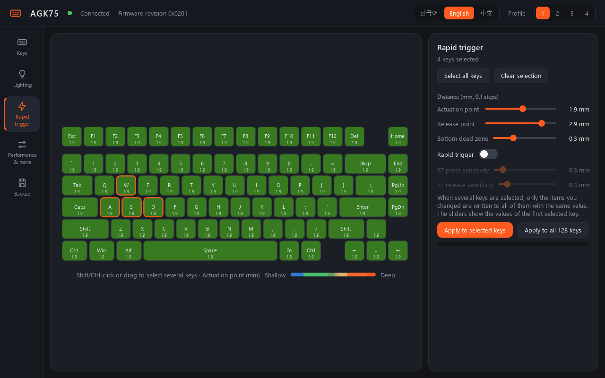
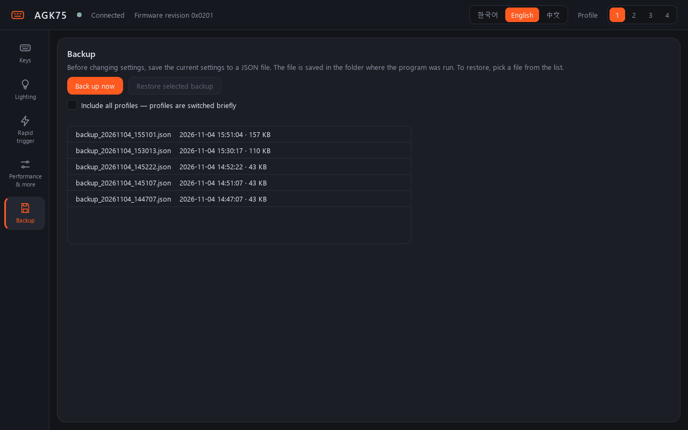

# agk75-tool

[한국어](README.md) | **English** | [简体中文](README.zh-CN.md)

> **This is an unofficial tool, not affiliated with Antgamer. The product name is used only to indicate which device it works with.**
>
> No liability is accepted for any damage arising from its use. The filter driver feature may conflict with Memory Integrity (HVCI) and game anti-cheat software.

A small program for configuring the ANTGAMER AGK75 (USB 3151:5009) while it is connected with a USB cable.
It uses only Python 3.11, `hidapi` (`import hid`), and `PySide6` (Qt: QtCore, QtGui, QtWidgets, QtSvg). The UI is a native PySide6 window: no CDN, and no outside connections except when the polling rate driver is downloaded.
The UI language is Korean, English, or Simplified Chinese; switching it in the top bar redraws everything at once (it follows the Windows display language at first and remembers your choice in `%AppData%\DO0OG\AGK75Tool.ini`).
All device, administrator, and measurement work runs one after another on a single worker thread; the UI only receives the results and updates itself.

This program is an independent implementation based on an analysis of how the manufacturer's web configuration tool communicates.

## License

MIT License (`LICENSE`), copyright DO0OG.

## Dependencies and sources

- `hidapi` (Python binding, `import hid`): available under GPLv3, BSD, or the original hidapi license; this program uses it under the **BSD license**.
- `hidusbf` (SweetLow, https://github.com/LordOfMice/hidusbf): not bundled in the repository or the installer. It is downloaded from GitHub at run time when you use the polling rate change. The distributed files are public domain binaries.
- `installer\ChineseSimplified.isl`: the Simplified Chinese translation file for Inno Setup 6.5.0+ (listed at https://jrsoftware.org/files/istrans/ , original at https://raw.githubusercontent.com/jrsoftware/issrc/refs/heads/main/Files/Languages/ChineseSimplified.isl ), bundled for the setup wizard. Its license is the same as Inno Setup's.
- `PySide6` / Qt 6 (PySide6-Essentials: QtCore, QtGui, QtWidgets, QtSvg): used under the **LGPLv3**. The Qt libraries are shipped as separate DLL files in the install folder, so they can be replaced with another build of the same version. Source: https://code.qt.io/cgit/pyside/pyside-setup.git/ ; the notice is `installer\THIRD-PARTY-NOTICES.txt` (also installed into the app folder). Not affiliated with The Qt Company.
- Everything else uses only the standard library. Nuitka is used for the build and Inno Setup for the installer.

## Running

```
pip install hidapi PySide6-Essentials   # only needed when running from source
python -m agk75            # settings window (PySide6). The process ends as soon as the window is closed
python -m agk75 --dump     # save the whole current configuration to backup_<date>_<time>.json (includes raw response hex)
python -m agk75 --rate-reset   # remove the polling rate filter (asks for administrator rights)
python -m pytest tests     # unit tests and UI smoke tests (no keyboard and no visible window needed)
```

Before changing settings, take a backup once with `--dump`. The "Backup" menu in the UI does the same (saved to the folder you ran it from when run from source, and to `%AppData%\AGK75Tool\backups` for the installed program). To restore, pick a file in the "Backup" menu (only version 2 backups can be restored). If you close the window while a restore or an administrator task is running, a confirmation dialog appears first.

## Installer

```
python build_exe.py                  # dist\AGK75Tool.dist\AGK75Tool.exe (Nuitka, --enable-plugin=pyside6, unused Qt modules excluded)
"C:\Program Files (x86)\Inno Setup 6\ISCC.exe" installer\AGK75Tool.iss   # dist\installer\AGK75Tool-Setup-1.0.0.exe
```

The default install location is `C:\Program Files\AGK75 Tool` (administrator rights; the command-line option `/CURRENTUSER` installs to the user folder). The setup wizard starts with a language selection dialog (Korean, English, Simplified Chinese; the Simplified Chinese file builds without warnings on Inno Setup 6.5.0 or later). Backups are stored in `%AppData%\AGK75Tool\backups` and are kept after uninstalling. The program does not use the network except to download the polling rate driver. The build folder (`dist\AGK75Tool.dist`) is about 72 MB and the installer (`AGK75Tool-Setup-1.0.0.exe`) is about 21.2 MB (the earlier web-UI version was about 20 MB / 7.1 MB). Recreate the icon with `python make_icon.py`.

## Features

The screenshots were taken by only reading the real keyboard (no writes). The UI language is Korean, English, or Simplified Chinese; lighting effect names keep their original English name, with only the annotation changing per language.

- Top bar: connection status (checked every 2 seconds; after a disconnect it reconnects and reads again automatically), firmware revision, switching the active profile (1-4), language switch
- Every write is read back with the matching read command, and "Applied" is shown only when the values are equal. If they differ, a red banner and a bottom toast are shown; exceptions are shown as translated text in the bottom toast.

### Keys


A polling rate card (sets 8000/4000/2000/1000Hz with the PC-side filter driver — not yet verified on real hardware), reassigning single keys on layers 0-3 (from the picture, from a list, or by pressing a real key), and restoring defaults (returns to the keymap and Fn layers read from the device on first connection and saved to `%APPDATA%\AGK75Tool\factory_<device id>.json` (the working folder when run from source). The button is disabled if there is no saved copy. The saved copy is created by reading only and never writes to the device). The polling rate card in the screenshot shows a real keyboard that already has the filter applied.

### Lighting


24 effects, speed, brightness, option, color (color dialog and 7 presets), and rainbow mode. Side lighting (9 effects) is configured the same way. A change is sent to the device once, 300 ms after the last change, and the glow under the keyboard picture previews the color.

### Rapid trigger



Per-key actuation/release point, bottom dead zone, rapid trigger on/off, and press/release sensitivity (0.1 mm steps). Shift/Ctrl-click or drag to pick several keys, then apply to the selected keys or to all keys (128 slots); applying to all shows a progress bar. The actuation point of each key is drawn as a heat map.

### Performance & more


Debounce (ms), sleep time display, device option toggles (Win key lock, Mac mode (firmware write bit position not verified), WASD↔arrow keys, LEDs off, side LEDs off, keyboard lock, Fn matrix, power saving mode), and measurement of the USB negotiated value and the Raw Input polling rate (result and histogram).

### Backup / restore



Saves and restores the four sub-profile keymaps per layer, Fn, the magnetic switch data of the current profile (including DKS), lighting, side lighting, options, and debounce. After restoring, everything is read back and any items that differ from the backup are shown.

## Changing the polling rate (PC side)

**The result has not been confirmed yet.** On 2026-11-04 the driver install, filter registration, bInterval write, and device restart command were run on a real PC, but the device is waiting for a reboot, so whether the polling rate actually changes is unconfirmed. The bInterval table below is still a hypothesis.

- Principle: the keyboard firmware has no polling rate command, so the Windows USB filter driver `hidusbf` (SweetLow, repository https://github.com/LordOfMice/hidusbf, distributed as "Public Domain binaries") is used to change the device's interrupt endpoint interval (bInterval). At High-Speed, all interrupt endpoints of this keyboard have bInterval 1 (125µs, 8000Hz).
- UI: the polling rate card in "Keys". Click "Prepare driver" (download → extract only the `.inf` and `hidusbf.sys` → use NoPatch if present → check that the Authenticode signature is valid and the signer is "Microsoft Windows Hardware Compatibility Publisher"), then choose 4000/2000/1000Hz. 8000Hz means the filter is removed. The self-signed Setup.exe, sx64.exe, and hidusbfn.zip are not used. The download address is `ratectl.PKG_URL` (`hidusbf.zip` in the repository) and has not actually been downloaded yet.
- Apply order: (the first time) `rundll32 setupapi,InstallHinfSection DefaultInstall 132 <INF>` → add `hidusbf` to `LowerFilters` (REG_MULTI_SZ) of the keyboard's parent composite device (`USB\VID_3151&PID_5009\<instance>`, found with `pnputil /enum-devices /connected` or registry enumeration) → write `Device Parameters\bInterval` (REG_DWORD) → `pnputil /restart-device`. This is done by relaunching the program itself as administrator (`--admin <job file>`); before starting, that device's key is saved with `reg export` to `%AppData%\AGK75Tool\admin\<number>.reg`. The administrator side accepts only the six fixed operations and the device ID format, and checks the signature again before installing. On PCs where User Account Control (UAC) is not set to "elevate without prompting", a permission prompt appears.
- bInterval table (`ratectl.RATE_TABLE`): 8000=1, 4000=2, 2000=3, 1000=4 (hypothesis A: 125µs × 2^(n-1)). If hypothesis B (milliseconds, 1=1000Hz) is correct, the table has to be fixed. That is why, after applying, the UI waits for the device to reconnect and then reads the USB negotiated value again; if it cannot be read, it shows "cannot be verified — measure in Performance & more".
- Warnings
  - If Memory Integrity (HVCI) is on, patch-style drivers do not load. This program prefers the NoPatch driver, which is meant for lowering the rate, but it shows a warning on the card when HVCI is on.
  - Some game anti-cheat software may reject or block third-party filter drivers.
  - Before uninstalling the driver (`HIDUSBFU.INF`), `hidusbf` must first be removed from the LowerFilters of all devices and the devices restarted. If you uninstall first, that device stops working. This program has no driver uninstall feature; it only removes the filter.
- Recovery: `python -m agk75 --rate-reset` (`AGK75Tool.exe --rate-reset` for the installed program) deletes bInterval → removes hidusbf from LowerFilters → restarts the device. To do it by hand, in an administrator command prompt:
  ```
  reg delete "HKLM\SYSTEM\CurrentControlSet\Enum\USB\VID_3151&PID_5009\<instance>\Device Parameters" /v bInterval /f
  reg delete "HKLM\SYSTEM\CurrentControlSet\Enum\USB\VID_3151&PID_5009\<instance>" /v LowerFilters /f
  pnputil /restart-device "USB\VID_3151&PID_5009\<instance>"
  ```
  If LowerFilters had other entries, do not delete them; remove only `hidusbf`. You can also restore by double-clicking the backup `.reg`.

## Limitations

- Polling rate: the AGK75 has only two polling rates, chosen automatically by the connection type: 8000Hz wired and 1000Hz over 2.4G or Bluetooth wireless. No source mentions a selection menu or an Fn combination, so there is no setting command to send to the keyboard, and it can only be changed with the PC-side filter driver (see "Changing the polling rate (PC side)" above).
  - Sources: hands-on reviews https://zhuanlan.zhihu.com/p/716187682 , https://zhuanlan.zhihu.com/p/714363140 (they describe 8000Hz wired and 1000Hz wireless).
  - Results of tests on real hardware (device id 1846):

  | Test | Result |
  |---|---|
  | Polling rate selector of the configuration tool | An empty implementation on this model; it sends nothing |
  | Command from another firmware family (SET 3 / GET 131) | The value does not change |
  | Hidden register (SET 4 / GET 132) | Not the polling rate. It is an unvalidated byte that stores any value from 0 to 255, and the USB negotiated value does not change. So it was removed from `protocol.ALLOWED` |
  | USB negotiated value (wired) | Always 125µs (8000Hz) |

  In "Performance & more" you can check two measurements, read-only.
  - USB polling interval: sends `IOCTL_USB_GET_NODE_CONNECTION_INFORMATION_EX` to the parent hub to read the speed and the endpoint bInterval, then computes 125µs × 2^(bInterval-1) for High/Super and bInterval ms for Full/Low (the USB negotiated value in "Performance & more"). On this PC it is High, EP 0x81, bInterval 1, max packet 64 → 125µs, 8000Hz.
  - Raw Input measurement: collects only this keyboard's input timestamps (key contents are not stored) and estimates the nearest value among 125-8000Hz from the lowest 5% quantile of the event intervals. With fewer than 50 samples no estimate is made, and if the mashing is not fast enough the result comes out lower than the real rate.
- Battery: not supported, because there is no way to read it over a wired (USB) connection.
- Features whose writes have not been verified on real hardware: device option toggles other than LED off, Fn default restore. Side lighting and LED off were verified with write and read-back through the previous UI; the PySide6 UI write paths were only tested with a fake device. Only the transmitted bytes and their order were checked with unit tests (fake device). Backup restore was confirmed on real hardware with 0 differences two times in a row (2026-11-04).
- The code supports the magnetic switch data of all profiles (`dump(dev, all_profiles=True)`), but switching profiles is a write, so the default backup reads only the current profile.
- The keyboard picture places the device numbers (column*6+row) in a 75% 81-key layout. ISO-only keys (numbers 10 and 75) are not drawn.
- The Fn key itself (number 65) was removed from the keymap list, because changing it by mistake would make Fn combinations unusable.
- Firmware update, flash erase, boot entry, calibration, macros, and user pictures are out of scope, and the corresponding commands are never sent by the code (opcodes outside `protocol.ALLOWED` are rejected).
- The unit of the distance values (0.1 mm) and the meaning of "release point" were inferred from communication analysis. They may differ from the actual feel.
- The device takes up to a few seconds to apply a write (lighting is the slowest). The readback waits until the value is applied.
- While this program is open, do not run another configuration tool that uses the same configuration channel at the same time.

## Layout

- `agk75/protocol.py` 64-byte Feature report transfer, checksums, opcodes, GET/SET
- `agk75/service.py` UI-independent device, backup, and polling rate logic (input validation, readback checks, backup/restore, factory snapshot, measurement). The device is accessed by one task at a time
- `agk75/i18n.py` one ko/en/zh dictionary for the messages used by the UI and the logic. Errors are raised as key + values (`RateError("rate.device_missing")`) and translated into the current language when shown
- `agk75/ratectl.py` PC-side polling rate (hidusbf): reading status, downloading, signature check, administrator tasks
- `agk75/ui/` PySide6 UI: `main_window.py` (top bar, navigation, QStackedWidget, toasts), `chrome.py`, `keyboard_widget.py` (keyboard picture), `keys_page.py`, `rate_card.py`, `light_page.py`, `magnet_page.py`, `misc_page.py`, `backup_page.py`, `worker.py` (the single worker thread), `widgets.py`, `page.py`, `layout.py` (key layout), `theme.py` (QSS), `app.py`
- `agk75/__main__.py` opening the window, `--dump`, `--admin`, `--rate-reset` (`agk75_app.py` is the exe entry script)
- `build_exe.py`, `installer/AGK75Tool.iss`, `installer/THIRD-PARTY-NOTICES.txt`, `make_icon.py` installer build
- `docs/screenshots/` README screenshots (`<screen>_<ko|en|zh>.png`)
- `tests/test_protocol*.py` checksum, encoding, and decoding tests
- `tests/test_service.py`, `tests/test_service_ext.py` service tests (fake device): input validation, readback checks, snapshot, restore, measurement
- `tests/test_ratectl.py`, `tests/test_rate_service.py` polling rate tests (fake command execution and fake file system; no real installation or registry writes)
- `tests/test_i18n.py` checks that the three language dictionaries have matching keys and placeholders, and that the keys used by the UI code exist
- `tests/test_ui.py`, `tests/fakedev.py` UI smoke tests with `QT_QPA_PLATFORM=offscreen`: the five screens are created, three-language switching, writes go only to the worker thread, bad input is rejected, disconnect → reconnect, closing the window ends the process
