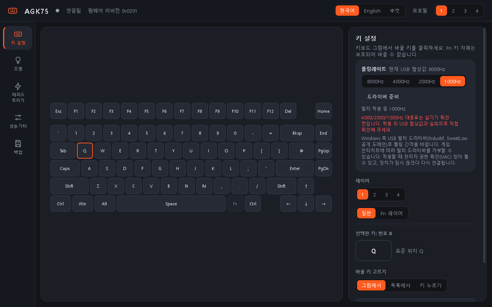

# agk75-tool

**한국어** | [English](README.en.md) | [简体中文](README.zh-CN.md)

> **비공식 도구 — Antgamer 와 무관합니다. 제품명은 호환 대상을 가리키는 용도입니다.**
> *This is an unofficial tool, not affiliated with Antgamer.*
>
> 사용에 따른 손해를 책임지지 않습니다. 필터 드라이버 기능은 메모리 무결성·게임 안티치트와 충돌할 수 있습니다.

ANTGAMER AGK75(USB 3151:5009)를 USB 선으로 연결한 상태에서 설정하는 작은 프로그램입니다.
Python 3.11, `hidapi`(`import hid`), `PySide6`(Qt: QtCore·QtGui·QtWidgets·QtSvg)만 씁니다. 화면은 PySide6 네이티브 창이며 CDN을 쓰지 않고, 폴링레이트 드라이버를 받을 때를 빼면 외부에 접속하지 않습니다.
화면 언어는 한국어·English·简体中文이며 상단 바에서 바꾸면 바로 다시 그려집니다(처음에는 Windows 표시 언어를 따르고, 고른 언어는 `%AppData%\DO0OG\AGK75Tool.ini` 에 기억합니다).
장치·관리자·측정 작업은 전부 작업 스레드 하나에서 차례로 실행되고, 화면은 그 결과만 받아 갱신합니다.

이 프로그램은 제조사 웹 설정 도구의 통신 방식을 분석해 독자적으로 구현했습니다.

## 라이선스

MIT 라이선스(`LICENSE`), 저작권자 DO0OG.

## 의존성과 출처

- `hidapi` (Python 바인딩, `import hid`): GPLv3 / BSD / 원본 hidapi 라이선스 중 선택할 수 있으며, 이 프로그램은 **BSD 라이선스**를 선택해 사용합니다.
- `hidusbf` (SweetLow, https://github.com/LordOfMice/hidusbf): 저장소와 설치 파일에 동봉하지 않습니다. 폴링레이트 변경을 쓸 때 실행 중에 GitHub 에서 받습니다. 배포 파일은 공개 도메인(Public Domain) 바이너리입니다.
- `installer\ChineseSimplified.isl`: Inno Setup 6.5.0+ 의 중국어 간체 번역 파일(https://jrsoftware.org/files/istrans/ 에 실린 것, 원본 https://raw.githubusercontent.com/jrsoftware/issrc/refs/heads/main/Files/Languages/ChineseSimplified.isl )을 설치 마법사용으로 동봉합니다. 라이선스는 Inno Setup 과 같습니다.
- `PySide6` / Qt 6 (PySide6-Essentials: QtCore·QtGui·QtWidgets·QtSvg): **LGPLv3** 로 씁니다. Qt 라이브러리는 설치 폴더에 DLL 로 따로 들어 있어 같은 버전의 다른 빌드로 바꿀 수 있습니다. 출처 https://code.qt.io/cgit/pyside/pyside-setup.git/ , 고지문은 `installer\THIRD-PARTY-NOTICES.txt`(설치 폴더에도 들어갑니다). Qt Company 와 무관합니다.
- 그 밖에 표준 라이브러리만 씁니다. 빌드에는 Nuitka, 설치 파일에는 Inno Setup 을 씁니다.

## 실행

```
pip install hidapi PySide6-Essentials   # 소스로 실행할 때만 필요
python -m agk75            # 설정 창(PySide6). 창을 닫으면 프로세스가 바로 끝남
python -m agk75 --dump     # 현재 설정 전체를 backup_날짜_시각.json 으로 저장(응답 원문 hex 포함)
python -m agk75 --rate-reset   # 폴링레이트 필터 해제(관리자 권한 요청)
python -m pytest tests     # 단위 테스트와 화면 스모크 시험(키보드 없이, 보이는 창 없이 실행됨)
```

설정을 바꾸기 전에 `--dump` 로 백업을 한 번 받아 두세요. 화면의 "백업" 메뉴도 같습니다(소스로 실행하면 실행한 폴더, 설치한 프로그램은 `%AppData%\AGK75Tool\backups`에 저장). 복원은 "백업" 메뉴에서 파일을 골라 실행합니다(버전 2 형식 백업만 가능). 복원이나 관리자 작업이 진행 중일 때 창을 닫으면 확인 대화상자가 먼저 뜹니다.

## 설치 파일

```
python build_exe.py                  # dist\AGK75Tool.dist\AGK75Tool.exe (Nuitka, --enable-plugin=pyside6, 쓰지 않는 Qt 모듈 제외)
"C:\Program Files (x86)\Inno Setup 6\ISCC.exe" installer\AGK75Tool.iss   # dist\installer\AGK75Tool-Setup-1.0.0.exe
```

기본 설치 위치는 `C:\Program Files\AGK75 Tool`(관리자 권한, 명령줄 `/CURRENTUSER`로 사용자 폴더 설치 가능)입니다. 설치 마법사는 한국어·English·简体中文 중 언어를 고르는 창으로 시작합니다(중국어 간체 번역 파일은 Inno Setup 6.5.0 이상에서 경고 없이 빌드됩니다). 백업은 `%AppData%\AGK75Tool\backups`에 저장되며 제거해도 남습니다. 이 프로그램은 폴링레이트 드라이버를 받을 때를 빼면 네트워크를 쓰지 않습니다. 빌드 폴더(`dist\AGK75Tool.dist`)는 약 72 MB, 설치 파일(`AGK75Tool-Setup-1.0.0.exe`)은 약 21.2 MB 입니다(이전 웹 화면 방식은 약 20 MB / 7.1 MB). 아이콘은 `python make_icon.py`로 다시 만듭니다.

## 지원 기능

화면 스크린샷은 실기기를 읽기만 하고(쓰기 없음) 찍은 것입니다. 화면 언어는 한국어·English·简体中文이며, 조명 효과 이름은 영문 원명을 그대로 두고 병기명만 언어별로 붙입니다.

- 상단 바: 연결 상태(2초마다 확인, 끊기면 자동으로 다시 연결해 읽어 옴), 펌웨어 리비전, 활성 프로필(1~4) 전환, 언어 전환
- 쓰기는 모두 대응하는 읽기 명령으로 되읽어 값이 같을 때만 "적용됨"으로 표시합니다. 다르면 화면 위에 빨간 띠와 하단 토스트로 알리고, 예외는 번역된 문구로 하단 토스트에 보여 줍니다.

### 키 설정



폴링레이트 카드(PC 쪽 필터 드라이버로 8000/4000/2000/1000Hz 설정 — 실기기 확인 전), 레이어 0~3의 키 하나씩 다시 지정(그림·목록·실제 키 입력), 기본값 복원(처음 연결했을 때 장치에서 읽어 `%APPDATA%\AGK75Tool\factory_<장치번호>.json`(소스 실행은 작업 폴더)에 저장해 둔 키맵·Fn 레이어로 되돌림. 저장본이 없으면 버튼이 비활성화됨. 저장본은 읽기만으로 만들며 장치에 쓰지 않음). 스크린샷의 폴링레이트 카드는 필터가 이미 걸려 있는 실기기를 읽은 모습입니다.

### 조명


효과 24종, 속도, 밝기, 옵션, 색(색 선택 창·프리셋 7색), 무지개 모드. 측면 조명(효과 9종)도 같은 방식으로 설정합니다. 값을 바꾸면 300ms 뒤 한 번만 장치에 보내고, 키보드 그림 아래쪽 빛으로 색을 미리 보여 줍니다.

### 래피드 트리거


키별 작동/해제 거리, 하단 데드존, 래피드 트리거 켜기/끄기, 누름/해제 감도(0.1mm 단위). Shift·Ctrl 클릭이나 끌기로 여러 키를 골라 선택 키 또는 모든 키(128칸)에 적용하며, 전체 적용은 진행률을 보여 줍니다. 키마다 작동 거리를 열지도로 그립니다.

### 성능·기타


디바운스(ms), 절전 시간 표시, 장치 옵션 토글(Win 잠금, mac 모드(펌웨어 쓰기 비트 위치 미검증), WASD↔방향키, LED 끄기, 측면 LED 끄기, 키보드 잠금, Fn 매트릭스, 절전 모드), USB 협상값·Raw Input 폴링레이트 실측(결과와 히스토그램).

### 백업 / 복원


레이어별 서브프로필 4개 키맵, Fn, 현재 프로필의 자기 축(DKS 포함), 조명, 측면 조명, 옵션, 디바운스를 저장하고 되돌립니다. 복원 뒤 전체를 다시 읽어 백업과 다른 항목을 보여 줍니다.

## 폴링레이트 변경(PC 쪽)

**적용 결과는 아직 확인 전입니다.** 2026-11-04에 실제 PC에서 드라이버 설치, 필터 등록, bInterval 쓰기, 장치 재시작 명령까지 실행했지만, 장치가 재부팅 대기 상태라 폴링레이트가 실제로 바뀌는지는 확인하지 못했습니다. 아래 bInterval 대응표도 가설입니다.

- 원리: 키보드 펌웨어에는 폴링레이트 명령이 없어서, Windows 의 USB 필터 드라이버 `hidusbf`(SweetLow, 저장소 https://github.com/LordOfMice/hidusbf, 배포 파일은 "Public Domain binaries")가 장치의 인터럽트 엔드포인트 간격(bInterval)을 바꾸게 합니다. 이 키보드는 High-Speed 에서 모든 인터럽트 EP 의 bInterval 이 1(125µs, 8000Hz)입니다.
- 화면: "키 설정"의 폴링레이트 카드. "드라이버 준비"(내려받기 → `.inf`·`hidusbf.sys` 만 추출 → NoPatch 가 있으면 그것을 사용 → Authenticode 서명이 유효하고 서명자가 "Microsoft Windows Hardware Compatibility Publisher" 인지 확인)를 누른 뒤 4000/2000/1000Hz 를 고릅니다. 8000Hz 는 필터 해제입니다. 자체 서명인 Setup.exe·sx64.exe·hidusbfn.zip 은 쓰지 않습니다. 내려받는 주소는 `ratectl.PKG_URL`(저장소의 `hidusbf.zip`)이며 아직 실제로 받아 보지 않았습니다.
- 적용 순서: (처음이면) `rundll32 setupapi,InstallHinfSection DefaultInstall 132 <INF>` → 키보드 부모 복합 장치(`USB\VID_3151&PID_5009\<인스턴스>`, `pnputil /enum-devices /connected` 또는 레지스트리 열거로 찾음)의 `LowerFilters`(REG_MULTI_SZ)에 `hidusbf` 추가 → `Device Parameters\bInterval`(REG_DWORD) 기록 → `pnputil /restart-device`. 이 작업은 자기 자신을 관리자로 다시 띄워(`--admin <작업 파일>`) 수행하며, 시작 전에 그 장치 키를 `reg export` 로 `%AppData%\AGK75Tool\admin\<번호>.reg` 에 백업합니다. 관리자 쪽은 정해진 6가지 작업과 장치 ID 형식만 받고, 설치 전에 서명을 다시 확인합니다. 사용자 계정 컨트롤(UAC)이 "묻지 않고 상승"이 아닌 PC 에서는 권한 확인 창이 뜹니다.
- bInterval 대응표(`ratectl.RATE_TABLE`): 8000=1, 4000=2, 2000=3, 1000=4 (가설 A: 125µs × 2^(n-1)). 가설 B(ms 단위, 1=1000Hz)가 맞으면 표를 고쳐야 합니다. 그래서 화면은 적용 뒤 장치 재연결을 기다렸다가 USB 협상값을 다시 읽어 보여 주고, 읽을 수 없으면 "확인 불가 — 성능·기타에서 실측"이라고 표시합니다.
- 경고
  - 메모리 무결성(HVCI)이 켜져 있으면 패치형 드라이버는 로드되지 않습니다. 이 프로그램은 낮추는 방향에 쓰는 NoPatch 드라이버를 우선 쓰지만, 켜져 있으면 카드에 경고를 띄웁니다.
  - 일부 게임 안티치트는 서드파티 필터 드라이버를 거부하거나 차단할 수 있습니다.
  - 드라이버를 제거(`HIDUSBFU.INF`)하기 전에는 모든 장치의 LowerFilters 에서 `hidusbf` 를 먼저 빼고 장치를 재시작해야 합니다. 먼저 지우면 해당 장치가 동작하지 않습니다. 이 프로그램에는 드라이버 제거 기능이 없고 필터 해제까지만 합니다.
- 복구: `python -m agk75 --rate-reset`(설치한 프로그램은 `AGK75Tool.exe --rate-reset`)이 bInterval 삭제 → LowerFilters 에서 hidusbf 제거 → 장치 재시작을 합니다. 손으로 할 때는 관리자 명령 프롬프트에서
  ```
  reg delete "HKLM\SYSTEM\CurrentControlSet\Enum\USB\VID_3151&PID_5009\<인스턴스>\Device Parameters" /v bInterval /f
  reg delete "HKLM\SYSTEM\CurrentControlSet\Enum\USB\VID_3151&PID_5009\<인스턴스>" /v LowerFilters /f
  pnputil /restart-device "USB\VID_3151&PID_5009\<인스턴스>"
  ```
  LowerFilters 에 다른 항목이 있었다면 지우지 말고 `hidusbf` 만 빼세요. 백업 `.reg` 를 더블클릭해 되돌릴 수도 있습니다.

## 한계

- 폴링레이트: AGK75 는 폴링레이트가 두 가지뿐이며 연결 방식으로 자동 결정됩니다. 유선 8000Hz, 2.4G·블루투스 무선 1000Hz 입니다. 선택 메뉴나 Fn 조합은 어떤 출처에도 없어서, 키보드로 보내는 설정 명령은 없고, PC 쪽 필터 드라이버로만 바꿀 수 있습니다(아래 "폴링레이트 변경(PC 쪽)").
  - 출처: 사용기 https://zhuanlan.zhihu.com/p/716187682 , https://zhuanlan.zhihu.com/p/714363140 (유선 8000Hz, 무선 1000Hz 라고 서술).
  - 실기기 시험 결과(장치 id 1846):

  | 시험 | 결과 |
  |---|---|
  | 설정 도구의 폴링레이트 선택기 | 이 기종에서는 빈 구현이라 아무것도 보내지 않음 |
  | 다른 펌웨어 계열의 명령 (SET 3 / GET 131) | 값이 바뀌지 않음 |
  | 숨은 레지스터 (SET 4 / GET 132) | 폴링레이트가 아님. 0~255 아무 값이나 저장하는 검증 없는 바이트이고 USB 협상값은 변하지 않음. 그래서 `protocol.ALLOWED` 에서 뺌 |
  | USB 협상값(유선) | 항상 125µs (8000Hz) |

  "성능·기타"에서는 실측 두 가지를 읽기 전용으로 확인할 수 있습니다.
  - USB 폴링 간격: 부모 허브에 `IOCTL_USB_GET_NODE_CONNECTION_INFORMATION_EX` 를 보내 속도와 엔드포인트 bInterval 을 읽고, High/Super 는 125µs × 2^(bInterval-1), Full/Low 는 bInterval ms 로 계산합니다("성능·기타"의 USB 협상값). 이 PC 에서는 High, EP 0x81, bInterval 1, 최대 패킷 64 → 125µs, 8000Hz 입니다.
  - Raw Input 실측: 이 키보드의 입력 시각만 모아(키 내용은 저장하지 않음) 이벤트 간격의 하위 5% 분위값에서 125~8000Hz 중 가까운 값을 추정합니다. 표본이 50개 미만이면 추정하지 않으며, 연타가 충분히 빠르지 않으면 실제보다 낮게 나옵니다.
- 배터리: 유선(USB) 연결에서는 읽을 방법이 없어 지원하지 않습니다.
- 실기기에서 쓰기를 확인하지 않은 기능: LED 끄기를 뺀 장치 옵션 토글, Fn 기본값 복원. 측면 조명과 LED 끄기는 이전 화면에서 실기기 쓰기와 되읽기를 확인했고, PySide6 화면의 쓰기 경로는 가짜 장치로만 시험했습니다. 단위 테스트(가짜 장치)로 전송 바이트와 순서만 확인했습니다. 백업 복원은 실기기에서 2회 연속 차이 0건을 확인했습니다(2026-11-04).
- 프로필별 자기 축은 코드가 모든 프로필을 지원하지만(`dump(dev, all_profiles=True)`), 프로필 전환이 쓰기라서 기본 백업은 현재 프로필 것만 읽습니다.
- 키 배열 그림은 장치 번호(열*6+행)를 75% 81키 배열로 놓은 것입니다. ISO 전용 키(10, 75번)는 그리지 않습니다.
- Fn 키(65번) 자체는 키맵 목록에서 뺐습니다. 잘못 바꾸면 Fn 조합을 쓸 수 없게 되기 때문입니다.
- 펌웨어 업데이트, 플래시 지우기, 부트 진입, 캘리브레이션, 매크로, 사용자 그림은 범위 밖이며 해당 명령은 코드에서 보내지지 않습니다(`protocol.ALLOWED` 밖의 opcode 는 거부).
- 거리 값의 단위(0.1mm)와 "해제 거리"의 의미는 통신 분석으로 추정한 것입니다. 실제 체감과 다를 수 있습니다.
- 장치는 쓰기를 반영하는 데 최대 몇 초가 걸립니다(조명이 가장 느림). 되읽기는 반영될 때까지 기다립니다.
- 프로그램이 열려 있는 동안 같은 설정 채널을 쓰는 다른 설정 도구는 동시에 실행하지 마세요.

## 구성

- `agk75/protocol.py` 64바이트 Feature report 송수신, 체크섬, opcode, GET/SET
- `agk75/service.py` 화면과 무관한 장치·백업·폴링레이트 로직(입력 검증, 되읽기 판정, 백업/복원, factory 스냅샷, 측정). 장치는 한 번에 하나의 작업만 접근
- `agk75/i18n.py` 화면과 로직이 쓰는 문구 사전(ko/en/zh 하나). 오류는 키+값(`RateError("rate.device_missing")`)으로 올리고 보여 줄 때 현재 언어로 번역
- `agk75/ratectl.py` PC 쪽 폴링레이트(hidusbf) 상태 읽기·내려받기·서명 확인·관리자 작업
- `agk75/ui/` PySide6 화면: `main_window.py`(상단 바·내비·QStackedWidget·토스트), `chrome.py`, `keyboard_widget.py`(키 그림), `keys_page.py`, `rate_card.py`, `light_page.py`, `magnet_page.py`, `misc_page.py`, `backup_page.py`, `worker.py`(단일 작업 스레드), `widgets.py`, `page.py`, `layout.py`(키 배치), `theme.py`(QSS), `app.py`
- `agk75/__main__.py` 창 실행, `--dump`, `--admin`, `--rate-reset` (`agk75_app.py`는 exe 진입 스크립트)
- `build_exe.py`, `installer/AGK75Tool.iss`, `installer/THIRD-PARTY-NOTICES.txt`, `make_icon.py` 설치 파일 빌드
- `docs/screenshots/` README 스크린샷(`<화면>_<ko|en|zh>.png`)
- `tests/test_protocol*.py` 체크섬·인코딩·디코딩 테스트
- `tests/test_service.py`, `tests/test_service_ext.py` 서비스 테스트(가짜 장치): 입력 검증, 되읽기 판정, 스냅샷, 복원, 측정
- `tests/test_ratectl.py`, `tests/test_rate_service.py` 폴링레이트 테스트(가짜 명령 실행·가짜 파일 시스템, 실제 설치·레지스트리 쓰기 없음)
- `tests/test_i18n.py` 세 언어 사전의 키·자리표시자 일치, 화면 코드가 쓰는 키의 존재 검사
- `tests/test_ui.py`, `tests/fakedev.py` `QT_QPA_PLATFORM=offscreen` 화면 스모크 시험: 5개 화면 생성, 언어 3종 전환, 쓰기가 작업 스레드로만 가는지, 잘못된 입력 거부, 끊김→재연결, 창 닫기 종료
