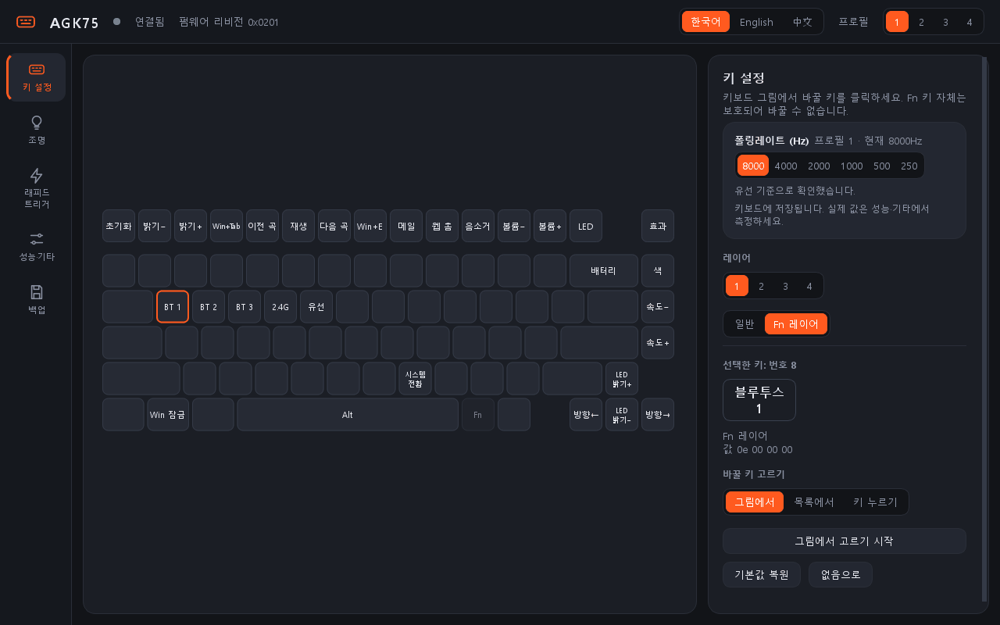
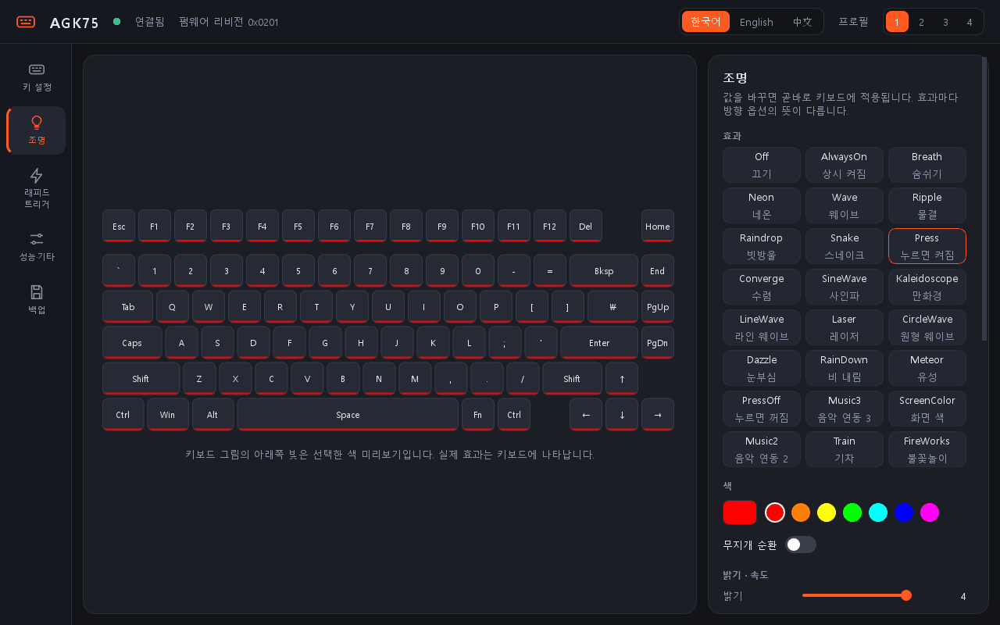
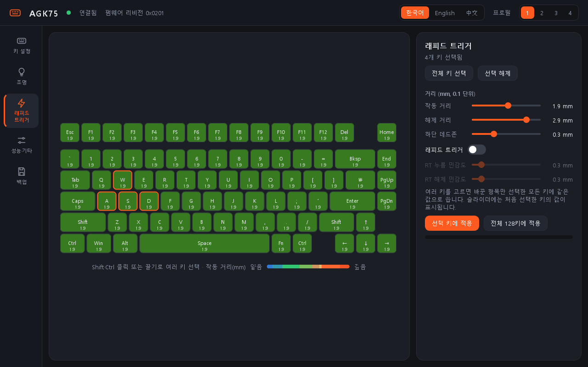
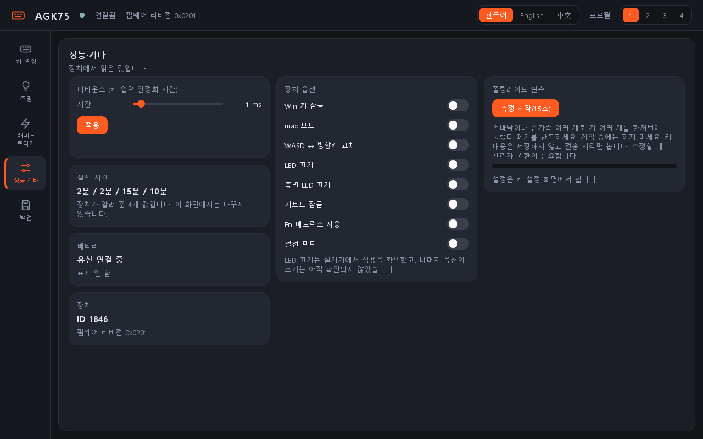
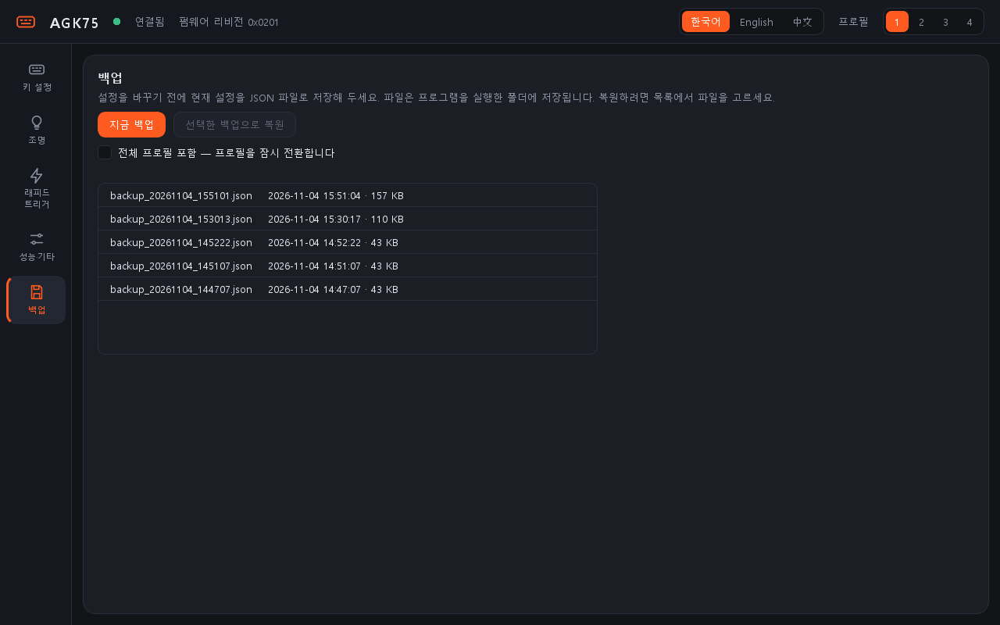

# agk75-tool

**한국어** | [English](README.en.md) | [简体中文](README.zh-CN.md)

> **비공식 도구 — Antgamer 와 무관합니다. 제품명은 호환 대상을 가리키는 용도입니다.**
> *This is an unofficial tool, not affiliated with Antgamer.*
>
> 사용에 따른 손해를 책임지지 않습니다.

ANTGAMER AGK75(USB 3151:5009)를 USB 선으로 연결한 상태에서 설정하는 작은 프로그램입니다.
Python 3.11, `hidapi`(`import hid`), `PySide6`(Qt: QtCore·QtGui·QtWidgets·QtSvg)만 씁니다. 화면은 PySide6 네이티브 창이며 CDN을 쓰지 않고, 외부에 접속하지 않습니다.
화면 언어는 한국어·English·简体中文이며 상단 바에서 바꾸면 바로 다시 그려집니다(처음에는 Windows 표시 언어를 따르고, 고른 언어는 `%AppData%\DO0OG\AGK75Tool.ini` 에 기억합니다).
장치 작업과 측정의 시작·상태 확인은 전부 작업 스레드 하나에서 차례로 실행되고(측정 자체는 별도 스레드에서 진행해 작업 스레드를 막지 않으며, 측정 중에는 장치 읽기·쓰기가 막힘), 화면은 그 결과만 받아 갱신합니다.

이 프로그램은 제조사 웹 설정 도구의 통신 방식을 분석해 독자적으로 구현했습니다.

## 라이선스

MIT 라이선스(`LICENSE`), 저작권자 DO0OG.

## 의존성과 출처

- `hidapi` (Python 바인딩, `import hid`): GPLv3 / BSD / 원본 hidapi 라이선스 중 선택할 수 있으며, 이 프로그램은 **BSD 라이선스**를 선택해 사용합니다.
- `installer\ChineseSimplified.isl`: Inno Setup 6.5.0+ 의 중국어 간체 번역 파일(https://jrsoftware.org/files/istrans/ 에 실린 것, 원본 https://raw.githubusercontent.com/jrsoftware/issrc/refs/heads/main/Files/Languages/ChineseSimplified.isl )을 설치 마법사용으로 동봉합니다. 라이선스는 Inno Setup 과 같습니다.
- `PySide6` / Qt 6 (PySide6-Essentials: QtCore·QtGui·QtWidgets·QtSvg): **LGPLv3** 로 씁니다. Qt 라이브러리는 설치 폴더에 DLL 로 따로 들어 있어 같은 버전의 다른 빌드로 바꿀 수 있습니다. 출처 https://code.qt.io/cgit/pyside/pyside-setup.git/ , 고지문은 `installer\THIRD-PARTY-NOTICES.txt`(설치 폴더에도 들어갑니다). Qt Company 와 무관합니다.
- 그 밖에 표준 라이브러리만 씁니다. 빌드에는 Nuitka, 설치 파일에는 Inno Setup 을 씁니다.

## 실행

```
pip install hidapi PySide6-Essentials   # 소스로 실행할 때만 필요
python -m agk75            # 설정 창(PySide6). 창을 닫으면 프로세스가 바로 끝남
python -m agk75 --dump     # 현재 설정 전체를 backup_날짜_시각.json 으로 저장(응답 원문 hex 포함)
python -m pytest tests     # 단위 테스트와 화면 스모크 시험(키보드 없이, 보이는 창 없이 실행됨)
```

설정을 바꾸기 전에 `--dump` 로 백업을 한 번 받아 두세요. 화면의 "백업" 메뉴도 같습니다(소스로 실행하면 실행한 폴더, 설치한 프로그램은 `%AppData%\AGK75Tool\backups`에 저장). 복원은 "백업" 메뉴에서 파일을 골라 실행합니다(버전 2 형식 백업만 가능). 복원이 진행 중일 때 창을 닫으면 확인 대화상자가 먼저 뜹니다.

## 설치 파일

```
python build_exe.py                  # dist\AGK75Tool.dist\AGK75Tool.exe (Nuitka, --enable-plugin=pyside6, 쓰지 않는 Qt 모듈 제외)
"C:\Program Files (x86)\Inno Setup 6\ISCC.exe" installer\AGK75Tool.iss   # dist\installer\AGK75Tool-Setup-1.0.0.exe
```

기본 설치 위치는 `C:\Program Files\AGK75 Tool`(관리자 권한, 명령줄 `/CURRENTUSER`로 사용자 폴더 설치 가능)입니다. 설치 마법사는 한국어·English·简体中文 중 언어를 고르는 창으로 시작합니다(중국어 간체 번역 파일은 Inno Setup 6.5.0 이상에서 경고 없이 빌드됩니다). 백업은 `%AppData%\AGK75Tool\backups`에 저장되며 제거해도 남습니다. 이 프로그램은 네트워크를 쓰지 않습니다. 빌드 폴더(`dist\AGK75Tool.dist`)는 약 73 MB, 설치 파일(`AGK75Tool-Setup-1.0.0.exe`)은 약 21.7 MB 입니다(이전 웹 화면 방식은 약 20 MB / 7.1 MB). 아이콘은 `python make_icon.py`로 다시 만듭니다.

## 지원 기능

화면 스크린샷은 실기기를 읽기만 하고(쓰기 없음) 찍은 것입니다. 화면 언어는 한국어·English·简体中文이며, 조명 효과 이름은 영문 원명을 그대로 두고 병기명만 언어별로 붙입니다.

- 상단 바: 연결 상태(2초마다 확인, 끊기면 자동으로 다시 연결해 읽어 옴), 펌웨어 리비전, 활성 프로필(1~4) 전환, 언어 전환
- 쓰기는 모두 대응하는 읽기 명령으로 되읽어 값이 같을 때만 "적용됨"으로 표시합니다. 다르면 화면 위에 빨간 띠와 하단 토스트로 알리고, 예외는 번역된 문구로 하단 토스트에 보여 줍니다.

### 키 설정




폴링레이트 카드(8000/4000/2000/1000/500/250Hz 중 하나를 눌러 키보드에 바로 씀. 현재 프로필의 값을 되읽어 강조함), 레이어 0~3의 키 하나씩 다시 지정(그림·목록·실제 키 입력), 기본값 복원(처음 연결했을 때 장치에서 읽어 `%APPDATA%\AGK75Tool\factory_<장치번호>.json`(소스 실행은 작업 폴더)에 저장해 둔 키맵·Fn 레이어로 되돌림. 저장본이 없으면 버튼이 비활성화됨. 저장본은 읽기만으로 만들며 장치에 쓰지 않음). 스크린샷의 폴링레이트 카드는 실기기 값을 읽어 채운 모습이고, 두 번째 스크린샷은 Fn 레이어를 고른 모습입니다.

### 조명



효과 24종, 속도, 밝기, 옵션, 색(색 선택 창·프리셋 7색), 무지개 모드. 측면 조명(효과 9종)도 같은 방식으로 설정합니다. 값을 바꾸면 300ms 뒤 한 번만 장치에 보내고, 키보드 그림 아래쪽 빛으로 색을 미리 보여 줍니다.

### 래피드 트리거



키별 작동/해제 거리, 하단 데드존, 래피드 트리거 켜기/끄기, 누름/해제 감도(0.1mm 단위). Shift·Ctrl 클릭이나 끌기로 여러 키를 골라 선택 키 또는 모든 키(128칸)에 적용하며, 전체 적용은 진행률을 보여 줍니다. 키마다 작동 거리를 열지도로 그립니다.

### 성능·기타



디바운스(ms), 절전 시간 표시, 장치 옵션 토글(Win 잠금, mac 모드(펌웨어 쓰기 비트 위치 미검증), WASD↔방향키, LED 끄기, 측면 LED 끄기, 키보드 잠금, Fn 매트릭스, 절전 모드), USB 추적 기반 폴링레이트 실측(15초, 관리자 권한 필요, 최소 간격 대역과 0~2ms 분포).

### 백업 / 복원



레이어별 서브프로필 4개 키맵, Fn, 현재 프로필의 자기 축(DKS 포함), 조명, 측면 조명, 옵션, 디바운스, 폴링레이트를 저장하고 되돌립니다. 복원 뒤 전체를 다시 읽어 백업과 다른 항목을 보여 줍니다.

## 폴링레이트

폴링레이트는 키보드 펌웨어의 레지스터에 쓰며, "키 설정" 화면의 카드에서 고릅니다. 프로필마다 따로 저장됩니다.

- 명령: 쓰기 `SET [4, 프로필, 코드]`(체크섬은 byte 7), 읽기 `GET [132, 프로필]`(응답의 byte 2 가 코드). 재연결 없이 바로 적용되고, 쓴 값은 USB 를 다시 꽂아도 유지됩니다. 프로필 0 에서만 측정했고, 다른 프로필도 같은 방식이라고 보고 같은 명령을 씁니다.
- 레지스터는 범위 밖 값도 그대로 저장하므로, 프로그램은 아래 표의 값만 쓰고 읽은 값이 표 밖이면 "읽을 수 없음"으로 표시합니다. 쓴 뒤에는 반드시 되읽어 같을 때만 "적용됨"으로 알립니다.
- 백업에는 프로필별 폴링레이트가 들어가며, 복원할 때는 값이 있고 표 안일 때만 씁니다(옛 백업에는 이 항목이 없어 건너뜁니다).

| 코드 | 폴링레이트 | 확인 결과 (프로필 0, 유선, "성능·기타" 실측) |
|---|---|---|
| 5 | 250Hz | 4ms 간격 — 앞선 주기 측정으로 확인 |
| 4 | 500Hz | 2ms 간격 — 앞선 주기 측정으로 확인 |
| 3 | 1000Hz | 최소 간격 대역 0.96~1.0ms (이론 주기 1.0ms) |
| 2 | 2000Hz | 최소 간격 대역 0.47~0.50ms (이론 주기 0.5ms) |
| 1 | 4000Hz | 최소 간격 대역 0.22~0.25ms (이론 주기 0.25ms) |
| 0 | 8000Hz | 최소 간격 대역 0.117~0.122ms (이론 주기 0.125ms) |
| 6 | (쓰지 않음) | 주기가 없어 125Hz 가 아님 |

- 코드 3, 2, 1, 0 은 각각 약 1000건의 전송 간격을 손바닥으로 키 여러 개를 동시에 눌러 얻었습니다. 대역 밖에 이상치가 몇 개 있었습니다(예: 코드 0 에서 0.032, 0.066, 0.090ms). 앞 패킷의 완료 기록이 늦어 생기는 것으로 보이며, 판정은 이런 이상치에 흔들리지 않게 만들었습니다.
- 전송 시각은 어느 설정에서나 0.125ms 눈금에 맞을 수 있어 격자·주기성(Rayleigh) 판정은 근거가 못 됩니다. 근거는 관찰된 가장 짧은 간격 대역입니다.
- 무선 모드에서 제한이 있는지는 확인하지 않았습니다. 위 결과는 유선 연결에서 얻었습니다.
- USB 허브가 보고하는 폴링 간격은 펌웨어가 보내는 빈도와 무관하게 항상 125µs 라서 판단 근거로 쓸 수 없습니다. 그래서 화면에도 표시하지 않습니다.

### 실측 방법

"성능·기타"의 측정 카드는 Windows 의 USB 이벤트 추적(ETW)으로 이 키보드의 인터럽트 IN 전송 완료 시각만 모아 15초 동안 간격을 분석합니다. 드라이버나 필터는 설치하지 않고, 키 내용(페이로드)은 수집하지 않으며 시각과 엔드포인트 주소만 씁니다.

1. 손바닥이나 손가락 여러 개로 키 여러 개를 한꺼번에 눌렀다 떼기를 반복하세요. 키 상태가 계속 바뀌면 펌웨어가 폴링 주기마다 리포트를 보내 연속한 전송 간격이 폴링 주기까지 줄어듭니다. 게임 중에는 하지 마세요.
2. 측정을 시작하면 프로그램이 자기 자신을 관리자 권한으로 `--trace <작업 파일>` 로 다시 실행합니다(소스 실행은 `python -m agk75 --trace ...`). 환경에 따라 사용자 계정 컨트롤(UAC) 창이 뜰 수 있습니다. 관리자 쪽은 추적 세션을 열고 15초 뒤 닫은 다음 tracerpt 로 변환해 간격만 결과 파일에 적고, 어떤 경로로 끝나도 세션을 멈추고 임시 파일(ETL·XML)을 지웁니다. 측정 중에는 장치 설정 읽기·쓰기가 막힙니다.
3. 보안: 작업 파일은 `%APPDATA%\AGK75Tool\admin\<uuid>.ops.json` 만 허용하고(실제 경로를 비교), JSON 에서는 초 수(3~60 정수)만 받으며 실행할 명령을 받지 않습니다. 결과 파일 이름은 관리자 쪽이 정하고, 실행하는 프로그램은 System32 의 `logman`, `tracerpt` 고정 경로뿐입니다. 검증에 실패하면 아무것도 쓰지 않고 끝납니다.
4. 판정은 엔드포인트(0x81, 0x82)별로 따로 합니다. 이론 주기 후보 0.125, 0.25, 0.5, 1, 2, 4ms 마다 주기의 0.85~1.05배 대역에 든 간격 수를 세고, 그 대역보다 짧은 간격이 상위 표본의 10% 이하인 가장 짧은 주기를 최소 주기로 판정합니다(실측에서 최소 간격은 주기의 0.88배까지 내려갔습니다). 4.2ms 이하의 짧은 간격이 30개 미만이거나 대역에 든 간격이 10개 미만이면 "판정 불가: 키 여러 개를 동시에 눌러 다시 재세요"입니다.
5. 이것은 관찰된 최소 간격이라서 실제 폴링레이트는 측정값 이상일 수 있습니다. 대역에 든 간격이 50개 미만이면 "최소 이 정도"라고 표시합니다.
6. 결과에는 측정 Hz, 최소 간격 대역, 표본 수, 0~2ms 짧은 간격 분포(0.125ms 단위)가 나오고, 키보드에 저장된 설정값과 다르면 차이를 알려 줍니다.

## 한계

- 폴링레이트: 위 "폴링레이트" 절의 표를 따릅니다. 프로필 0 이외와 무선 모드는 확인하지 않았습니다. 실측은 관찰한 최소 간격이라서 키를 충분히 여러 개 눌러야 하고, 관리자 권한이 필요합니다.
- 배터리: 유선(USB) 연결에서는 읽을 방법이 없어 지원하지 않습니다.
- 실기기에서 쓰기를 확인하지 않은 기능: LED 끄기를 뺀 장치 옵션 토글, Fn 기본값 복원. 측면 조명과 LED 끄기는 이전 화면에서 실기기 쓰기와 되읽기를 확인했고, PySide6 화면의 쓰기 경로는 가짜 장치로만 시험했습니다. 단위 테스트(가짜 장치)로 전송 바이트와 순서만 확인했습니다. 백업 복원은 실기기에서 2회 연속 차이 0건을 확인했습니다(2026-11-04).
- 프로필별 자기 축은 코드가 모든 프로필을 지원하지만(`dump(dev, all_profiles=True)`), 프로필 전환이 쓰기라서 기본 백업은 현재 프로필 것만 읽습니다.
- 키 배열 그림은 장치 번호(열*6+행)를 75% 81키 배열로 놓은 것입니다. ISO 전용 키(10, 75번)는 그리지 않습니다.
- Fn 키(65번) 자체는 키맵 목록에서 뺐습니다. 잘못 바꾸면 Fn 조합을 쓸 수 없게 되기 때문입니다.
- 펌웨어 업데이트, 플래시 지우기, 부트 진입, 캘리브레이션, 매크로, 사용자 그림은 범위 밖이며 해당 명령은 코드에서 보내지지 않습니다(`protocol.ALLOWED` 밖의 opcode 는 거부).
- 거리 값의 단위(0.1mm)와 "해제 거리"의 의미는 통신 분석으로 추정한 것입니다. 실제 체감과 다를 수 있습니다.
- 장치는 쓰기를 반영하는 데 최대 몇 초가 걸립니다(조명이 가장 느림). 되읽기는 반영될 때까지 기다립니다.
- 프로그램이 열려 있는 동안 같은 설정 채널을 쓰는 다른 설정 도구는 동시에 실행하지 마세요.

## 구성

- `agk75/protocol.py` 64바이트 Feature report 송수신, 체크섬, opcode, GET/SET
- `agk75/service.py` 화면과 무관한 장치·백업·폴링레이트 로직(입력 검증, 되읽기 판정, 백업/복원, factory 스냅샷, 측정). 장치는 한 번에 하나의 작업만 접근
- `agk75/usbtrace.py` 폴링레이트 실측: USB 추적에서 엔드포인트별 최소 간격 대역 판정, 관리자 쪽 `--trace` 처리와 작업 파일 검증
- `agk75/i18n.py` 화면과 로직이 쓰는 문구 사전(ko/en/zh 하나). 오류는 키+값(`MsgError("err.no_change")`)으로 올리고 보여 줄 때 현재 언어로 번역
- `agk75/ui/` PySide6 화면: `main_window.py`(상단 바·내비·QStackedWidget·토스트), `chrome.py`, `keyboard_widget.py`(키 그림), `keys_page.py`, `rate_card.py`, `light_page.py`, `magnet_page.py`, `misc_page.py`, `backup_page.py`, `worker.py`(단일 작업 스레드), `widgets.py`, `page.py`, `layout.py`(키 배치), `theme.py`(QSS), `app.py`
- `agk75/__main__.py` 창 실행, `--dump`, `--trace`(관리자 측정용) (`agk75_app.py`는 exe 진입 스크립트)
- `build_exe.py`, `installer/AGK75Tool.iss`, `installer/THIRD-PARTY-NOTICES.txt`, `make_icon.py` 설치 파일 빌드
- `docs/screenshots/` README 스크린샷(`<화면>_<ko|en|zh>.png`)
- `tests/test_protocol*.py` 체크섬·인코딩·디코딩 테스트
- `tests/test_service.py`, `tests/test_service_ext.py` 서비스 테스트(가짜 장치): 입력 검증, 되읽기 판정, 스냅샷, 복원, 측정
- `tests/test_usbtrace.py` 최소 간격 판정(실측 분포 픽스처), 작업 파일 거부 사례, 결과 경로, 세션 정리 호출 순서(가짜 실행기)
- `tests/test_i18n.py` 세 언어 사전의 키·자리표시자 일치, 화면 코드가 쓰는 키의 존재 검사
- `tests/test_ui.py`, `tests/fakedev.py` `QT_QPA_PLATFORM=offscreen` 화면 스모크 시험: 5개 화면 생성, 언어 3종 전환, 쓰기가 작업 스레드로만 가는지, 잘못된 입력 거부, 끊김→재연결, 창 닫기 종료
