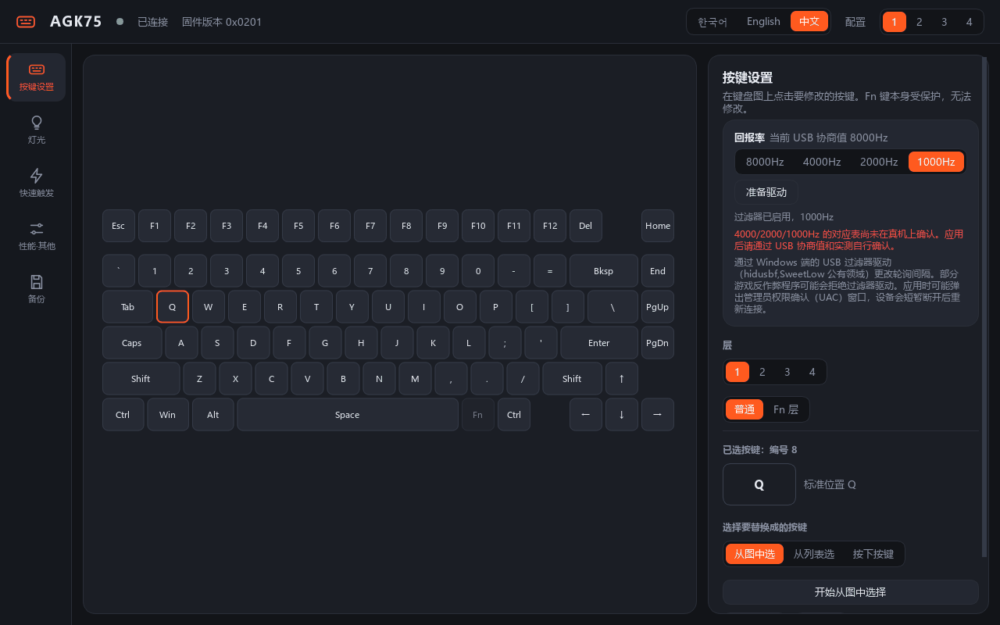
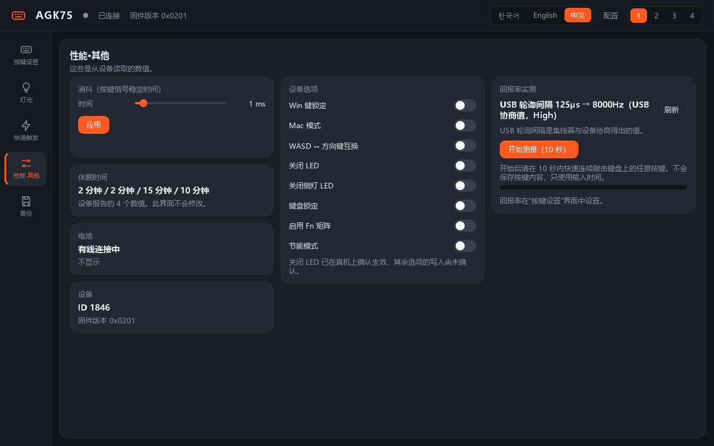
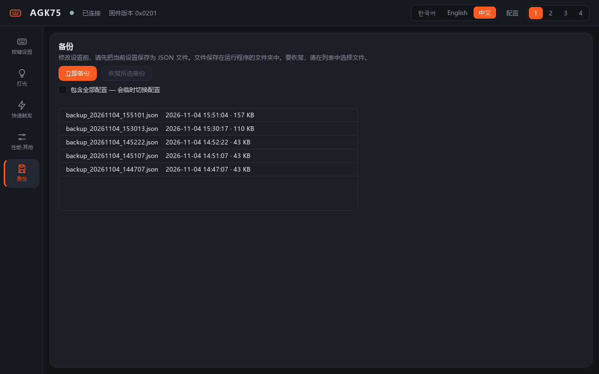

# agk75-tool

[한국어](README.md) | [English](README.en.md) | **简体中文**

> **这是非官方工具，与 Antgamer 无关（This is an unofficial tool, not affiliated with Antgamer）。产品名称仅用于说明兼容对象。**
>
> 对于因使用本工具造成的任何损失，作者概不负责。过滤器驱动功能可能与内存完整性（HVCI）及游戏反作弊软件冲突。

这是一个小程序，用于在通过 USB 线连接 ANTGAMER AGK75（USB 3151:5009）时对其进行设置。
只使用 Python 3.11、`hidapi`（`import hid`）和 `PySide6`（Qt：QtCore、QtGui、QtWidgets、QtSvg）。界面是 PySide6 原生窗口，不使用 CDN，除下载回报率驱动外不进行任何外部连接。
界面语言为韩语、英语和简体中文，在顶部栏切换后会立即重绘（首次使用时跟随 Windows 显示语言，所选语言记录在 `%AppData%\DO0OG\AGK75Tool.ini`）。
设备、管理员和测量任务全部在同一个工作线程中依次执行，界面只接收结果并刷新。

本程序通过分析厂商网页设置工具的通信方式，独立实现。

## 许可证

MIT 许可证（`LICENSE`），版权所有者 DO0OG。

## 依赖与来源

- `hidapi`（Python 绑定，`import hid`）：可在 GPLv3 / BSD / 原版 hidapi 许可证中任选，本程序选择 **BSD 许可证**。
- `hidusbf`（SweetLow，https://github.com/LordOfMice/hidusbf）：不随仓库和安装包分发。使用回报率更改功能时，会在运行时从 GitHub 下载。发布的文件是公有领域（Public Domain）二进制文件。
- `installer\ChineseSimplified.isl`：Inno Setup 6.5.0+ 的简体中文翻译文件（列于 https://jrsoftware.org/files/istrans/ ，原文件 https://raw.githubusercontent.com/jrsoftware/issrc/refs/heads/main/Files/Languages/ChineseSimplified.isl ），随附供安装向导使用。许可证与 Inno Setup 相同。
- `PySide6` / Qt 6（PySide6-Essentials：QtCore、QtGui、QtWidgets、QtSvg）：按 **LGPLv3** 使用。Qt 库以 DLL 文件的形式单独放在安装文件夹中，可以替换为同一版本的其他构建。来源 https://code.qt.io/cgit/pyside/pyside-setup.git/ ，声明文件为 `installer\THIRD-PARTY-NOTICES.txt`（也会安装到程序文件夹）。与 The Qt Company 无关。
- 其余只使用标准库。构建使用 Nuitka，安装包使用 Inno Setup。

## 运行

```
pip install hidapi PySide6-Essentials   # 仅在从源码运行时需要
python -m agk75            # 设置窗口（PySide6）。关闭窗口后进程立即结束
python -m agk75 --dump     # 把当前全部设置保存为 backup_日期_时间.json（包含响应原始 hex）
python -m agk75 --rate-reset   # 解除回报率过滤器（会请求管理员权限）
python -m pytest tests     # 单元测试和界面冒烟测试（无需键盘，也不会显示窗口）
```

修改设置前，请先用 `--dump` 备份一次。界面中的“备份”菜单功能相同（从源码运行时保存在运行所在文件夹，安装版保存在 `%AppData%\AGK75Tool\backups`）。恢复时在“备份”菜单中选择文件即可（只能恢复版本 2 格式的备份）。恢复或管理员任务进行中关闭窗口时，会先弹出确认对话框。

## 安装包

```
python build_exe.py                  # dist\AGK75Tool.dist\AGK75Tool.exe (Nuitka, --enable-plugin=pyside6, 排除未使用的 Qt 模块)
"C:\Program Files (x86)\Inno Setup 6\ISCC.exe" installer\AGK75Tool.iss   # dist\installer\AGK75Tool-Setup-1.0.0.exe
```

默认安装位置为 `C:\Program Files\AGK75 Tool`（需要管理员权限，命令行加 `/CURRENTUSER` 可安装到用户文件夹）。安装向导以语言选择窗口开头（韩语、英语、简体中文；简体中文翻译文件在 Inno Setup 6.5.0 及以上版本中构建不会出现警告）。备份保存在 `%AppData%\AGK75Tool\backups`，卸载后仍会保留。除下载回报率驱动外，本程序不使用网络。构建文件夹（`dist\AGK75Tool.dist`）约 72 MB，安装包（`AGK75Tool-Setup-1.0.0.exe`）约 21.2 MB（之前的网页界面版本约为 20 MB / 7.1 MB）。图标可用 `python make_icon.py` 重新生成。

## 支持的功能

界面截图是只读取真机（不写入）后截取的。界面语言为韩语、英语、简体中文；灯效名称保留英文原名，只有附注按语言变化。

- 顶部栏：连接状态（每 2 秒检查一次，断开后会自动重新连接并读取）、固件版本、切换当前配置（1~4）、切换语言
- 所有写入都会用对应的读取命令回读，只有数值一致时才显示“已应用”。不一致时，在界面上方显示红色提示条并在底部弹出提示；异常会以翻译后的文字显示在底部提示中。

### 按键设置



回报率卡片（通过电脑端过滤器驱动设置 8000/4000/2000/1000Hz — 尚未在真机上确认）、重新指定层 0~3 中的单个按键（从图中选、从列表选、按下实际按键）、恢复默认（恢复为首次连接时从设备读取并保存到 `%APPDATA%\AGK75Tool\factory_<设备编号>.json`（从源码运行时为工作文件夹）的键位表和 Fn 层。没有保存文件时按钮会被禁用。保存文件只通过读取生成，不会写入设备）。截图中的回报率卡片是读取已经启用过滤器的真机时的样子。

### 灯光


24 种灯效、速度、亮度、选项、颜色（取色窗口和 7 个预设色）、彩虹模式。侧灯（9 种灯效）用同样的方式设置。修改后会在最后一次修改的 300ms 后只向设备发送一次，键盘图下方的光晕用来预览颜色。

### 快速触发


每个按键的触发行程/释放行程、底部死区、快速触发开/关、按下/释放灵敏度（0.1mm 为单位）。可用 Shift·Ctrl 点击或拖动选择多个按键，应用到所选按键或全部按键（128 格）；应用到全部时会显示进度条。每个按键的触发行程以热图显示。

### 性能·其他



消抖（ms）、休眠时间显示、设备选项开关（Win 键锁定、Mac 模式（固件写入位位置未验证）、WASD↔方向键、关闭 LED、关闭侧灯 LED、键盘锁定、Fn 矩阵、节能模式），以及 USB 协商值和 Raw Input 回报率实测（结果和直方图）。

### 备份 / 恢复



保存并恢复每层 4 个子配置的键位表、Fn、当前配置的磁轴数据（含 DKS）、灯光、侧灯、选项和消抖。恢复后会重新读取全部内容，并显示与备份不同的项目。

## 更改回报率（电脑端）

**实际效果尚未确认。** 2026-11-04 已在真实电脑上执行了驱动安装、过滤器注册、bInterval 写入和设备重启命令，但设备正在等待重新启动，因此尚未确认回报率是否真的改变。下面的 bInterval 对应表仍是假设。

- 原理：键盘固件中没有回报率命令，所以借助 Windows 的 USB 过滤器驱动 `hidusbf`（SweetLow，仓库 https://github.com/LordOfMice/hidusbf ，发布文件为“Public Domain binaries”）来更改设备中断端点的间隔（bInterval）。这块键盘在 High-Speed 下所有中断端点的 bInterval 都是 1（125µs，8000Hz）。
- 界面：“按键设置”中的回报率卡片。先点击“准备驱动”（下载 → 只提取 `.inf` 和 `hidusbf.sys` → 有 NoPatch 则使用 → 确认 Authenticode 签名有效且签名者为“Microsoft Windows Hardware Compatibility Publisher”），再选择 4000/2000/1000Hz。8000Hz 表示解除过滤器。不使用自签名的 Setup.exe、sx64.exe、hidusbfn.zip。下载地址为 `ratectl.PKG_URL`（仓库中的 `hidusbf.zip`），目前尚未实际下载过。
- 应用顺序：（首次）`rundll32 setupapi,InstallHinfSection DefaultInstall 132 <INF>` → 在键盘上级复合设备（`USB\VID_3151&PID_5009\<实例>`，通过 `pnputil /enum-devices /connected` 或枚举注册表找到）的 `LowerFilters`（REG_MULTI_SZ）中添加 `hidusbf` → 写入 `Device Parameters\bInterval`（REG_DWORD）→ `pnputil /restart-device`。这些操作通过让程序自身以管理员身份重新启动（`--admin <任务文件>`）来完成，开始前会用 `reg export` 把该设备的键备份到 `%AppData%\AGK75Tool\admin\<编号>.reg`。管理员一侧只接受固定的 6 种操作和设备 ID 格式，并在安装前再次验证签名。在用户帐户控制（UAC）不是“无提示提升”的电脑上，会弹出权限确认窗口。
- bInterval 对应表（`ratectl.RATE_TABLE`）：8000=1，4000=2，2000=3，1000=4（假设 A：125µs × 2^(n-1)）。如果假设 B（以 ms 为单位，1=1000Hz）才是对的，就需要修改这张表。因此界面在应用后会等待设备重新连接，再次读取 USB 协商值并显示；如果读取不到，会显示“无法确认 — 请在性能·其他中实测”。
- 警告
  - 开启内存完整性（HVCI）时，补丁型驱动无法加载。本程序优先使用用于降低回报率的 NoPatch 驱动，但在 HVCI 开启时会在卡片上显示警告。
  - 部分游戏反作弊程序可能会拒绝或拦截第三方过滤器驱动。
  - 卸载驱动（`HIDUSBFU.INF`）之前，必须先从所有设备的 LowerFilters 中移除 `hidusbf` 并重新启动设备。如果先卸载，该设备将无法工作。本程序没有卸载驱动的功能，只负责解除过滤器。
- 恢复：`python -m agk75 --rate-reset`（安装版为 `AGK75Tool.exe --rate-reset`）会删除 bInterval → 从 LowerFilters 中移除 hidusbf → 重新启动设备。手动操作时，请在管理员命令提示符中执行
  ```
  reg delete "HKLM\SYSTEM\CurrentControlSet\Enum\USB\VID_3151&PID_5009\<实例>\Device Parameters" /v bInterval /f
  reg delete "HKLM\SYSTEM\CurrentControlSet\Enum\USB\VID_3151&PID_5009\<实例>" /v LowerFilters /f
  pnputil /restart-device "USB\VID_3151&PID_5009\<实例>"
  ```
  如果 LowerFilters 中原本还有其他条目，不要整体删除，只移除 `hidusbf`。也可以双击备份的 `.reg` 文件来还原。

## 局限

- 回报率：AGK75 只有两种回报率，由连接方式自动决定。有线 8000Hz，2.4G·蓝牙无线 1000Hz。任何来源都没有提到选择菜单或 Fn 组合键，因此没有可以发送给键盘的设置命令，只能通过电脑端过滤器驱动更改（见上文“更改回报率（电脑端）”）。
  - 来源：使用体验文章 https://zhuanlan.zhihu.com/p/716187682 、https://zhuanlan.zhihu.com/p/714363140 （称有线 8000Hz，无线 1000Hz）。
  - 真机测试结果（设备 id 1846）：

  | 测试 | 结果 |
  |---|---|
  | 设置工具的回报率选择器 | 在该型号上是空实现，什么也不发送 |
  | 其他固件系列的命令（SET 3 / GET 131） | 数值没有变化 |
  | 隐藏寄存器（SET 4 / GET 132） | 不是回报率。它是一个不做校验、可保存 0~255 任意值的字节，USB 协商值不会改变。因此已从 `protocol.ALLOWED` 中移除 |
  | USB 协商值（有线） | 始终为 125µs（8000Hz） |

  在“性能·其他”中可以以只读方式查看两种实测。
  - USB 轮询间隔：向上级集线器发送 `IOCTL_USB_GET_NODE_CONNECTION_INFORMATION_EX`，读取速度和端点 bInterval；High/Super 按 125µs × 2^(bInterval-1) 计算，Full/Low 按 bInterval ms 计算（“性能·其他”中的 USB 协商值）。在这台电脑上为 High、EP 0x81、bInterval 1、最大包长 64 → 125µs，8000Hz。
  - Raw Input 实测：只收集这块键盘的输入时间（不保存按键内容），根据事件间隔的最低 5% 分位值，在 125~8000Hz 中估算最接近的值。样本少于 50 个时不做估算；如果连续敲击不够快，结果会比实际值低。
- 电池：有线（USB）连接下无法读取，因此不支持。
- 尚未在真机上确认写入的功能：除关闭 LED 以外的设备选项开关、Fn 默认值恢复。侧灯和关闭 LED 已通过之前的界面在真机上确认写入和回读；PySide6 界面的写入路径只用模拟设备测试过。只通过单元测试（模拟设备）确认了发送的字节和顺序。备份恢复已在真机上连续 2 次确认差异为 0 项（2026-11-04）。
- 代码支持读取所有配置的磁轴数据（`dump(dev, all_profiles=True)`），但切换配置本身属于写入操作，所以默认备份只读取当前配置。
- 键盘图把设备编号（列*6+行）按 75% 的 81 键布局排列。不绘制 ISO 专用键（10、75 号）。
- Fn 键（65 号）本身已从键位列表中去掉，因为误改会导致无法使用 Fn 组合键。
- 固件更新、擦除闪存、进入引导模式、校准、宏、自定义图片不在范围内，代码也不会发送相应的命令（`protocol.ALLOWED` 之外的 opcode 会被拒绝）。
- 行程数值的单位（0.1mm）和“释放行程”的含义是通过通信分析推测的，可能与实际手感不同。
- 设备应用写入最多需要几秒（灯光最慢）。回读会一直等到写入生效。
- 程序打开期间，请不要同时运行使用同一设置通道的其他设置工具。

## 结构

- `agk75/protocol.py` 64 字节 Feature report 收发、校验和、opcode、GET/SET
- `agk75/service.py` 与界面无关的设备、备份、回报率逻辑（输入校验、回读判定、备份/恢复、factory 快照、测量）。设备同一时间只处理一个任务
- `agk75/i18n.py` 界面和逻辑共用的提示词典（ko/en/zh 合为一个）。错误以键+参数（`RateError("rate.device_missing")`）抛出，显示时按当前语言翻译
- `agk75/ratectl.py` 电脑端回报率（hidusbf）：读取状态、下载、签名验证、管理员任务
- `agk75/ui/` PySide6 界面：`main_window.py`（顶部栏、导航、QStackedWidget、提示）、`chrome.py`、`keyboard_widget.py`（键盘图）、`keys_page.py`、`rate_card.py`、`light_page.py`、`magnet_page.py`、`misc_page.py`、`backup_page.py`、`worker.py`（单一工作线程）、`widgets.py`、`page.py`、`layout.py`（键位布局）、`theme.py`（QSS）、`app.py`
- `agk75/__main__.py` 打开窗口、`--dump`、`--admin`、`--rate-reset`（`agk75_app.py` 是 exe 入口脚本）
- `build_exe.py`、`installer/AGK75Tool.iss`、`installer/THIRD-PARTY-NOTICES.txt`、`make_icon.py` 安装包构建
- `docs/screenshots/` README 截图（`<界面>_<ko|en|zh>.png`）
- `tests/test_protocol*.py` 校验和、编码、解码测试
- `tests/test_service.py`、`tests/test_service_ext.py` 服务测试（模拟设备）：输入校验、回读判定、快照、恢复、测量
- `tests/test_ratectl.py`、`tests/test_rate_service.py` 回报率测试（模拟命令执行和模拟文件系统，不会进行真实安装或写入注册表）
- `tests/test_i18n.py` 检查三种语言词典的键和占位符是否一致，以及界面代码使用的键是否存在
- `tests/test_ui.py`、`tests/fakedev.py` 使用 `QT_QPA_PLATFORM=offscreen` 的界面冒烟测试：创建 5 个界面、三种语言切换、写入只经过工作线程、拒绝错误输入、断开→重连、关闭窗口即结束进程
