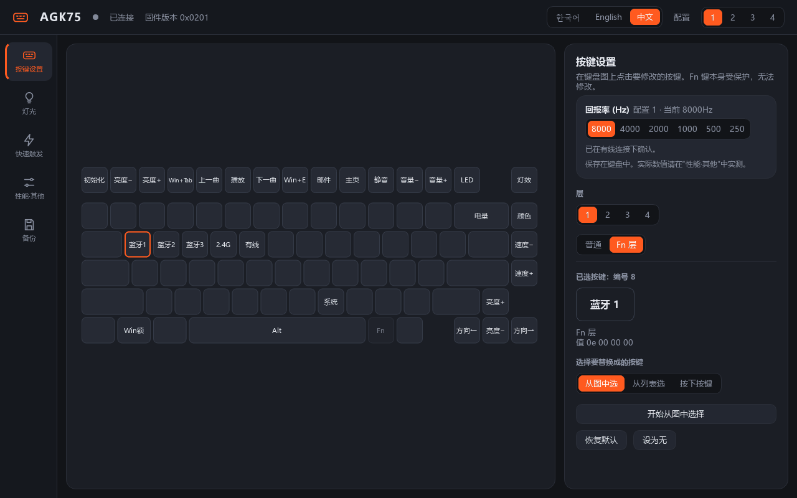
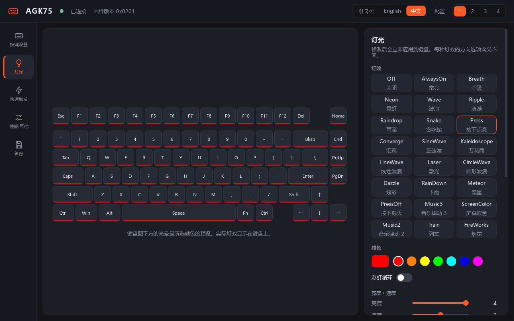
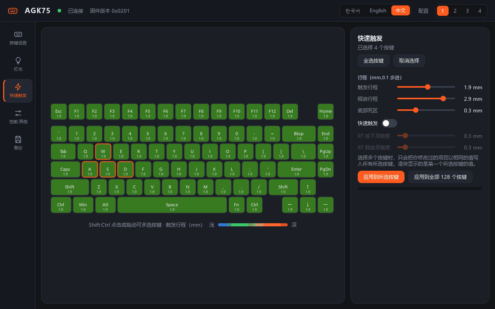

# agk75-tool

[한국어](README.md) | [English](README.en.md) | **简体中文**

> **这是非官方工具，与 Antgamer 无关（This is an unofficial tool, not affiliated with Antgamer）。产品名称仅用于说明兼容对象。**
>
> 对于因使用本工具造成的任何损失，作者概不负责。

这是一个小程序，用于在通过 USB 线连接 ANTGAMER AGK75（USB 3151:5009）时对其进行设置。
只使用 Python 3.11、`hidapi`（`import hid`）和 `PySide6`（Qt：QtCore、QtGui、QtWidgets、QtSvg）。界面是 PySide6 原生窗口，不使用 CDN，不进行任何外部连接。
界面语言为韩语、英语和简体中文，在顶部栏切换后会立即重绘（首次使用时跟随 Windows 显示语言，所选语言记录在 `%AppData%\DO0OG\AGK75Tool.ini`）。
设备任务以及测量的启动和状态查询全部在同一个工作线程中依次执行（测量本身在单独的线程中进行，不会阻塞工作线程；测量期间会阻止设备读写），界面只接收结果并刷新。

本程序通过分析厂商网页设置工具的通信方式，独立实现。

## 许可证

MIT 许可证（`LICENSE`），版权所有者 DO0OG。

## 依赖与来源

- `hidapi`（Python 绑定，`import hid`）：可在 GPLv3 / BSD / 原版 hidapi 许可证中任选，本程序选择 **BSD 许可证**。
- `installer\ChineseSimplified.isl`：Inno Setup 6.5.0+ 的简体中文翻译文件（列于 https://jrsoftware.org/files/istrans/ ，原文件 https://raw.githubusercontent.com/jrsoftware/issrc/refs/heads/main/Files/Languages/ChineseSimplified.isl ），随附供安装向导使用。许可证与 Inno Setup 相同。
- `PySide6` / Qt 6（PySide6-Essentials：QtCore、QtGui、QtWidgets、QtSvg）：按 **LGPLv3** 使用。Qt 库以 DLL 文件的形式单独放在安装文件夹中，可以替换为同一版本的其他构建。来源 https://code.qt.io/cgit/pyside/pyside-setup.git/ ，声明文件为 `installer\THIRD-PARTY-NOTICES.txt`（也会安装到程序文件夹）。与 The Qt Company 无关。
- 其余只使用标准库。构建使用 Nuitka，安装包使用 Inno Setup。

## 运行

```
pip install hidapi PySide6-Essentials   # 仅在从源码运行时需要
python -m agk75            # 设置窗口（PySide6）。关闭窗口后进程立即结束
python -m agk75 --dump     # 把当前全部设置保存为 backup_日期_时间.json（包含响应原始 hex）
python -m pytest tests     # 单元测试和界面冒烟测试（无需键盘，也不会显示窗口）
```

修改设置前，请先用 `--dump` 备份一次。界面中的“备份”菜单功能相同（从源码运行时保存在运行所在文件夹，安装版保存在 `%AppData%\AGK75Tool\backups`）。恢复时在“备份”菜单中选择文件即可（只能恢复版本 2 格式的备份）。恢复进行中关闭窗口时，会先弹出确认对话框。

## 安装包

```
python build_exe.py                  # dist\AGK75Tool.dist\AGK75Tool.exe (Nuitka, --enable-plugin=pyside6, 排除未使用的 Qt 模块)
"C:\Program Files (x86)\Inno Setup 6\ISCC.exe" installer\AGK75Tool.iss   # dist\installer\AGK75Tool-Setup-1.0.0.exe
```

默认安装位置为 `C:\Program Files\AGK75 Tool`（需要管理员权限，命令行加 `/CURRENTUSER` 可安装到用户文件夹）。安装向导以语言选择窗口开头（韩语、英语、简体中文；简体中文翻译文件在 Inno Setup 6.5.0 及以上版本中构建不会出现警告）。备份保存在 `%AppData%\AGK75Tool\backups`，卸载后仍会保留。本程序不使用网络。构建文件夹（`dist\AGK75Tool.dist`）约 73 MB，安装包（`AGK75Tool-Setup-1.0.0.exe`）约 21.7 MB（之前的网页界面版本约为 20 MB / 7.1 MB）。图标可用 `python make_icon.py` 重新生成。

## 支持的功能

界面截图是只读取真机（不写入）后截取的。界面语言为韩语、英语、简体中文；灯效名称保留英文原名，只有附注按语言变化。

- 顶部栏：连接状态（每 2 秒检查一次，断开后会自动重新连接并读取）、固件版本、切换当前配置（1~4）、切换语言
- 所有写入都会用对应的读取命令回读，只有数值一致时才显示“已应用”。不一致时，在界面上方显示红色提示条并在底部弹出提示；异常会以翻译后的文字显示在底部提示中。

### 按键设置




回报率卡片（点击 8000/4000/2000/1000/500/250Hz 之一即可立即写入键盘，并回读当前配置的值加以高亮）、重新指定层 0~3 中的单个按键（从图中选、从列表选、按下实际按键）、恢复默认（恢复为首次连接时从设备读取并保存到 `%APPDATA%\AGK75Tool\factory_<设备编号>.json`（从源码运行时为工作文件夹）的键位表和 Fn 层。没有保存文件时按钮会被禁用。保存文件只通过读取生成，不会写入设备）。截图中的回报率卡片是用从真机读取的值填充的，第二张截图是选择了 Fn 层的样子。

### 灯光



24 种灯效、速度、亮度、选项、颜色（取色窗口和 7 个预设色）、彩虹模式。侧灯（9 种灯效）用同样的方式设置。修改后会在最后一次修改的 300ms 后只向设备发送一次，键盘图下方的光晕用来预览颜色。

### 快速触发



每个按键的触发行程/释放行程、底部死区、快速触发开/关、按下/释放灵敏度（0.1mm 为单位）。可用 Shift·Ctrl 点击或拖动选择多个按键，应用到所选按键或全部按键（128 格）；应用到全部时会显示进度条。每个按键的触发行程以热图显示。

### 性能·其他


消抖（ms）、休眠时间显示、设备选项开关（Win 键锁定、Mac 模式（固件写入位位置未验证）、WASD↔方向键、关闭 LED、关闭侧灯 LED、键盘锁定、Fn 矩阵、节能模式），以及基于 USB 跟踪的回报率实测（15 秒，需要管理员权限，最小间隔区间和 0~2ms 分布）。

### 备份 / 恢复


保存并恢复每层 4 个子配置的键位表、Fn、当前配置的磁轴数据（含 DKS）、灯光、侧灯、选项、消抖和回报率。恢复后会重新读取全部内容，并显示与备份不同的项目。

## 回报率

回报率写入键盘固件中的寄存器，在“按键设置”界面的卡片中选择。每个配置分别保存。

- 命令：写入 `SET [4, 配置, 代码]`（校验和在 byte 7），读取 `GET [132, 配置]`（响应的 byte 2 为代码）。无需重新连接即可立即生效，写入的值在重新插拔 USB 后仍会保留。只在配置 0 上测量过，其他配置按相同方式处理，使用相同的命令。
- 寄存器也会保存超出范围的值，所以程序只写入下表中的值；读回的值不在表中时显示为“无法读取”。每次写入后都会回读，只有一致时才显示“已应用”。
- 备份中包含各配置的回报率；恢复时只有该值存在且在表中才会写入（旧备份没有此项，会跳过）。

| 代码 | 回报率 | 确认结果（配置 0，有线，在“性能·其他”中实测） |
|---|---|---|
| 5 | 250Hz | 4ms 间隔 — 已由之前的周期测量确认 |
| 4 | 500Hz | 2ms 间隔 — 已由之前的周期测量确认 |
| 3 | 1000Hz | 最小间隔区间 0.96~1.0ms（理论周期 1.0ms） |
| 2 | 2000Hz | 最小间隔区间 0.47~0.50ms（理论周期 0.5ms） |
| 1 | 4000Hz | 最小间隔区间 0.22~0.25ms（理论周期 0.25ms） |
| 0 | 8000Hz | 最小间隔区间 0.117~0.122ms（理论周期 0.125ms） |
| 6 | （不使用） | 没有周期，并不是 125Hz |

- 代码 3、2、1、0 各自用手掌同时按下多个按键，采集了约 1000 条传输间隔。区间之外有少量异常值（例如代码 0 的 0.032、0.066、0.090ms），似乎是前一个数据包的完成记录延迟造成的，判定方法已设计为不受这类异常值影响。
- 传输时间在任何设置下都可能落在 0.125ms 的刻度上，所以网格或周期性（Rayleigh）判定不能作为依据。依据是观察到的最短间隔区间。
- 无线模式下是否有限制尚未确认。上述结果是在有线连接下得到的。
- USB 集线器报告的轮询间隔与固件的发送频率无关，始终为 125µs，因此不能作为判断依据。所以界面中也不显示它。

### 实测方法

“性能·其他”中的测量卡片通过 Windows 的 USB 事件跟踪（ETW），只收集这块键盘中断 IN 传输的完成时间，并在 15 秒内分析间隔。不安装驱动或过滤器，不收集按键内容（负载），只使用时间和端点地址。

1. 请用手掌或多根手指同时按下再松开多个按键，并反复进行。按键状态不断变化时，固件会在每个轮询周期发送报告，连续传输的间隔会缩小到轮询周期。游戏中请勿测量。
2. 开始测量后，程序会以管理员权限用 `--trace <任务文件>` 重新运行自己（从源码运行为 `python -m agk75 --trace ...`）。视电脑环境，可能会弹出用户账户控制（UAC）窗口。管理员端打开跟踪会话，15 秒后关闭，用 tracerpt 转换，只把间隔写入结果文件，并且无论以何种方式结束，都会停止会话并删除临时文件（ETL、XML）。测量期间会阻止读取和写入设备设置。
3. 安全：任务文件只接受 `%APPDATA%\AGK75Tool\admin\<uuid>.ops.json`（按真实路径比较），JSON 中只接受秒数（3~60 的整数）而不接受命令，结果文件名由管理员端决定，运行的程序只有 System32 中固定路径的 `logman` 和 `tracerpt`。验证失败时什么都不写就退出。
4. 每个端点（0x81、0x82）分别判定。对每个理论周期候选 0.125、0.25、0.5、1、2、4ms，统计落在周期 0.85~1.05 倍区间内的间隔数，把比该区间更短的间隔不超过上位样本 10% 的最短周期判定为最小周期（实测中最小间隔最低到周期的 0.88 倍）。4.2ms 以内的短间隔少于 30 个，或区间内的间隔少于 10 个时，结果为“无法判定：请同时按下多个按键后重新测量”。
5. 这是观察到的最小间隔，所以实际回报率可能等于或高于测量值。区间内的间隔少于 50 个时，显示为“至少这么高”。
6. 结果显示测得的 Hz、最小间隔区间、样本数以及 0~2ms 的短间隔分布（以 0.125ms 为单位），与键盘中保存的设置值不同时会提示差异。

## 局限

- 回报率：以上文“回报率”一节的表为准。配置 0 以外的配置和无线模式尚未确认。实测观察的是最小间隔，所以需要同时按下足够多的按键，并且需要管理员权限。
- 电池：有线（USB）连接下无法读取，因此不支持。
- 尚未在真机上确认写入的功能：除关闭 LED 以外的设备选项开关、Fn 默认值恢复。侧灯和关闭 LED 已通过之前的界面在真机上确认写入和回读；PySide6 界面的写入路径只用模拟设备测试过。只通过单元测试（模拟设备）确认了发送的字节和顺序。备份恢复已在真机上连续 2 次确认差异为 0 项（2026-11-04）。
- 代码支持读取所有配置的磁轴数据（`dump(dev, all_profiles=True)`），但切换配置本身属于写入操作，所以默认备份只读取当前配置。
- 键盘图把设备编号（列*6+行）按 75% 的 81 键布局排列。不绘制 ISO 专用键（10、75 号）。
- Fn 键（65 号）本身已从键位列表中去掉，因为误改会导致无法使用 Fn 组合键。
- 固件更新、擦除闪存、进入引导模式、校准、宏、自定义图片不在范围内，代码也不会发送相应的命令（`protocol.ALLOWED` 之外的 opcode 会被拒绝）。
- 行程数值的单位（0.1mm）和“释放行程”的含义是通过通信分析推测的，可能与实际手感不同。
- 设备应用写入最多需要几秒（灯光最慢）。回读会一直等到写入生效。
- 程序打开期间，请不要同时运行使用同一设置通道的其他设置工具。

## 结构

- `agk75/protocol.py` 64 字节 Feature report 收发、校验和、opcode、GET/SET
- `agk75/service.py` 与界面无关的设备、备份、回报率逻辑（输入校验、回读判定、备份/恢复、factory 快照、测量）。设备同一时间只处理一个任务
- `agk75/usbtrace.py` 回报率实测：根据 USB 跟踪按端点判定最小间隔区间、管理员端 `--trace` 处理和任务文件校验
- `agk75/i18n.py` 界面和逻辑共用的提示词典（ko/en/zh 合为一个）。错误以键+参数（`MsgError("err.no_change")`）抛出，显示时按当前语言翻译
- `agk75/ui/` PySide6 界面：`main_window.py`（顶部栏、导航、QStackedWidget、提示）、`chrome.py`、`keyboard_widget.py`（键盘图）、`keys_page.py`、`rate_card.py`、`light_page.py`、`magnet_page.py`、`misc_page.py`、`backup_page.py`、`worker.py`（单一工作线程）、`widgets.py`、`page.py`、`layout.py`（键位布局）、`theme.py`（QSS）、`app.py`
- `agk75/__main__.py` 打开窗口、`--dump`、`--trace`（管理员测量用）（`agk75_app.py` 是 exe 入口脚本）
- `build_exe.py`、`installer/AGK75Tool.iss`、`installer/THIRD-PARTY-NOTICES.txt`、`make_icon.py` 安装包构建
- `docs/screenshots/` README 截图（`<界面>_<ko|en|zh>.png`）
- `tests/test_protocol*.py` 校验和、编码、解码测试
- `tests/test_service.py`、`tests/test_service_ext.py` 服务测试（模拟设备）：输入校验、回读判定、快照、恢复、测量
- `tests/test_usbtrace.py` 最小间隔判定（实测分布样例）、被拒绝的任务文件、结果路径、会话清理调用顺序（模拟执行器）
- `tests/test_i18n.py` 检查三种语言词典的键和占位符是否一致，以及界面代码使用的键是否存在
- `tests/test_ui.py`、`tests/fakedev.py` 使用 `QT_QPA_PLATFORM=offscreen` 的界面冒烟测试：创建 5 个界面、三种语言切换、写入只经过工作线程、拒绝错误输入、断开→重连、关闭窗口即结束进程
